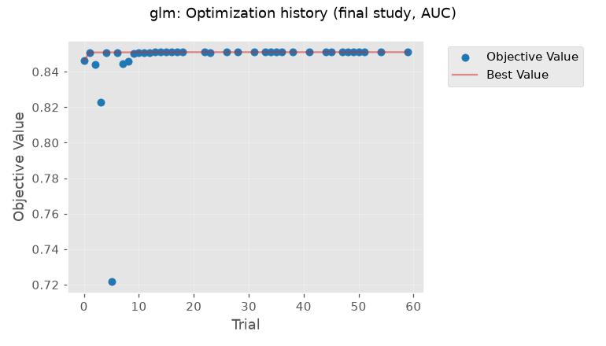
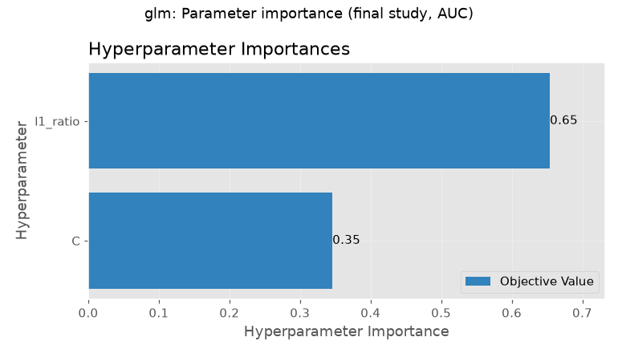
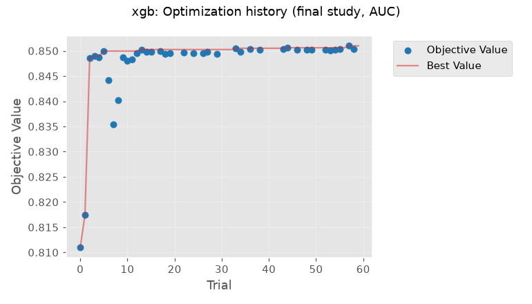
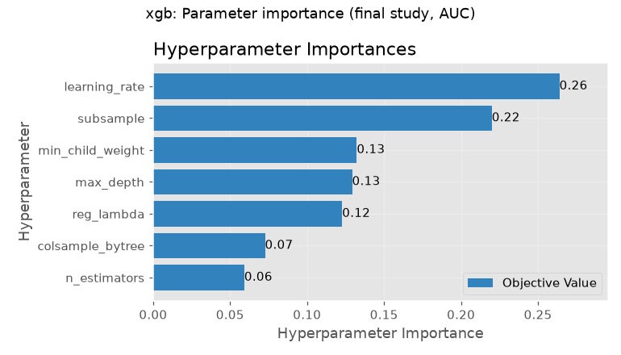
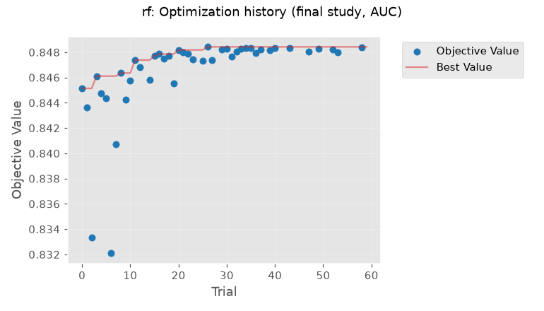
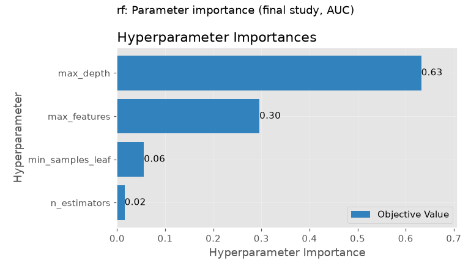

# Tuning report

Nested cross-validation with Optuna (TPE sampler, seed 42, median pruner, 60 trials per study). Training split only (5,634 customers). Associations only; nothing here is a causal effect.

Design: (1) outer loop for an honest score: 5 outer folds, each with its own 60-trial study on 3-fold inner CV of the outer-training rows, scored once on the outer-validation rows; (2) final study: 60 trials on 5-fold CV of the whole training split, saved to `models/optuna_<family>.db`, whose best parameters are used for the final model. Objective: mean AUC (how well the model ranks who will leave; 0.5 is a coin flip, 1.0 is perfect). For every trial we also stored top-20% revenue capture, PR-AUC, Brier (average squared error of the probability; lower is better) and fit time: see `tables/optuna_trials_<family>.csv`.

## Summary

| family | nested_auc_mean | nested_auc_sd | nested_top20_mean | nested_top20_sd | nested_prauc_mean | nested_brier_mean | nested_ece_mean | final_best_auc | final_best_auc_sd | trials | pruned |
|---|---|---|---|---|---|---|---|---|---|---|---|
| glm | 0.8503 | 0.0106 | 0.5526 | 0.0174 | 0.6731 | 0.1328 | 0.0235 | 0.8510 | 0.0064 | 60 | 21 |
| xgb | 0.8503 | 0.0088 | 0.5559 | 0.0167 | 0.6710 | 0.1332 | 0.0252 | 0.8510 | 0.0061 | 60 | 21 |
| rf | 0.8476 | 0.0064 | 0.5446 | 0.0163 | 0.6625 | 0.1343 | 0.0273 | 0.8484 | 0.0073 | 60 | 17 |

The nested score is the honest one. The final-study best AUC is optimistic by construction (best of 60 trials on the same folds).

## glm

### Search space

| parameter | range | why this range |
|---|---|---|
| C | log 0.001 to 10 | inverse penalty strength; log scale because useful values span orders of magnitude |
| l1_ratio | 0 to 1 | mix of ridge (0) and lasso (1) penalty; lasso can zero out weak columns |

### Best parameters (final study)

```
{
 "penalty": "elasticnet",
 "C": 9.512835184510749,
 "l1_ratio": 0.05281079501960359
}
```

Best final-study AUC 0.8510 (SD across its 5 folds 0.0064); top-20% revenue capture 0.551; Brier 0.1326; mean fit time 0.23 s per fit. Trials 60 (completed 39, pruned 21). Time: nested part 0.4 min, final study 0.9 min.
Nested outer-fold AUC 0.8503 +/- 0.0106 (5 folds); top-20% capture 0.553 +/- 0.017.

### Parameter importance (Optuna fANOVA-style, share of score variation explained; sums to 1)

| parameter | importance |
|---|---|
| l1_ratio | 0.654 |
| C | 0.346 |

### Plots





## xgb

### Search space

| parameter | range | why this range |
|---|---|---|
| n_estimators | 100 to 600 step 50 | number of boosting rounds |
| learning_rate | log 0.01 to 0.2 | step size |
| max_depth | 2 to 7 | tree depth; small data wants shallow trees |
| min_child_weight | log 1 to 30 | minimum summed weight in a leaf; guards against noise |
| subsample | 0.5 to 1.0 | share of rows per round |
| colsample_bytree | 0.4 to 1.0 | share of columns per tree |
| reg_lambda | log 0.01 to 30 | L2 penalty on leaf values |

### Best parameters (final study)

```
{
 "n_estimators": 400,
 "learning_rate": 0.030611087366257395,
 "max_depth": 2,
 "subsample": 0.6740062614932111,
 "colsample_bytree": 0.4575570590705051,
 "min_child_weight": 3.3279486334446977,
 "reg_lambda": 8.57791293314464
}
```

Best final-study AUC 0.8510 (SD across its 5 folds 0.0061); top-20% revenue capture 0.544; Brier 0.1329; mean fit time 0.10 s per fit. Trials 60 (completed 39, pruned 21). Time: nested part 0.6 min, final study 0.6 min.
Nested outer-fold AUC 0.8503 +/- 0.0088 (5 folds); top-20% capture 0.556 +/- 0.017.

### Parameter importance (Optuna fANOVA-style, share of score variation explained; sums to 1)

| parameter | importance |
|---|---|
| learning_rate | 0.264 |
| subsample | 0.220 |
| min_child_weight | 0.132 |
| max_depth | 0.129 |
| reg_lambda | 0.123 |
| colsample_bytree | 0.073 |
| n_estimators | 0.059 |

### Plots





## rf

### Search space

| parameter | range | why this range |
|---|---|---|
| n_estimators | 200 to 600 step 100 | more trees steady the average; gains stop early |
| max_depth | 3 to 14 | shallow trees cannot overfit; deep ones can |
| min_samples_leaf | 1 to 40 (log) | bigger leaves smooth the prediction; 40 of 4,500 rows is under 1% |
| max_features | 0.1 to 0.8 | share of columns tried at each split; lower decorrelates trees |

### Best parameters (final study)

```
{
 "n_estimators": 500,
 "min_samples_leaf": 14,
 "max_features": 0.23424555209166284,
 "max_depth": 7
}
```

Best final-study AUC 0.8484 (SD across its 5 folds 0.0073); top-20% revenue capture 0.540; Brier 0.1339; mean fit time 0.43 s per fit. Trials 60 (completed 43, pruned 17). Time: nested part 2.5 min, final study 1.9 min.
Nested outer-fold AUC 0.8476 +/- 0.0064 (5 folds); top-20% capture 0.545 +/- 0.016.

### Parameter importance (Optuna fANOVA-style, share of score variation explained; sums to 1)

| parameter | importance |
|---|---|
| max_depth | 0.632 |
| max_features | 0.296 |
| min_samples_leaf | 0.056 |
| n_estimators | 0.016 |

### Plots




