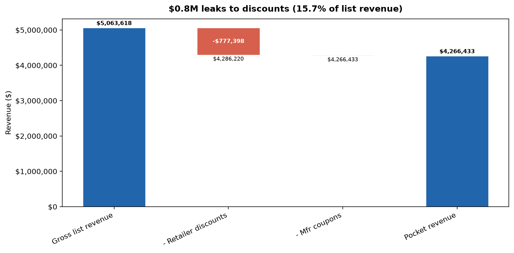
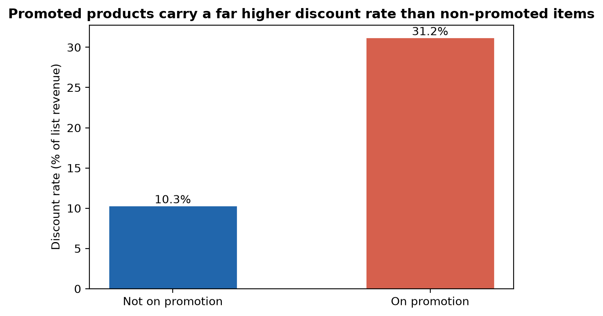
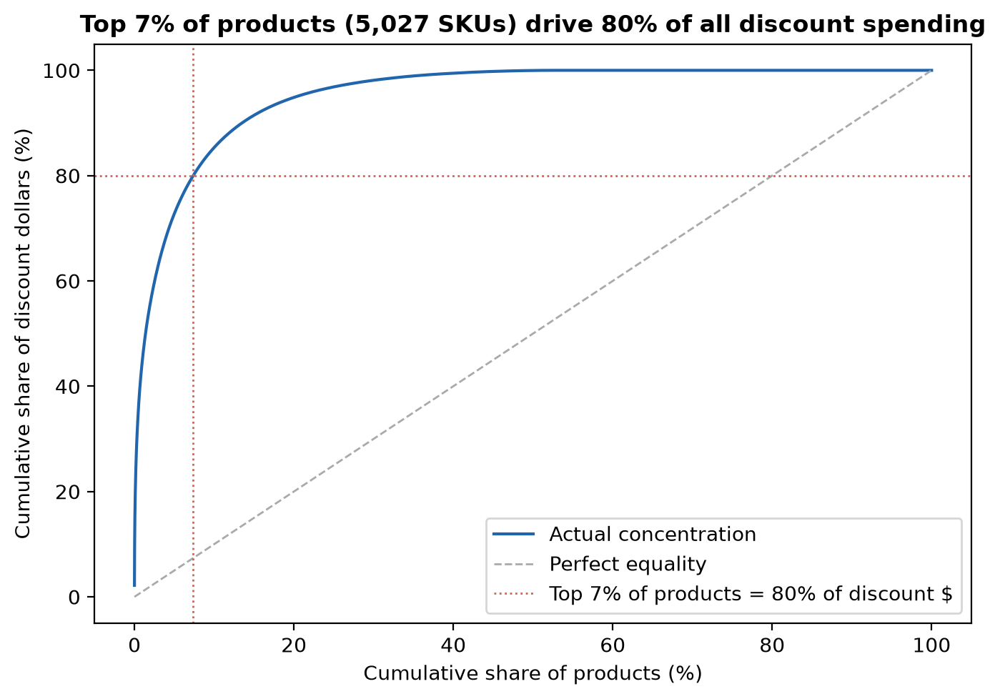
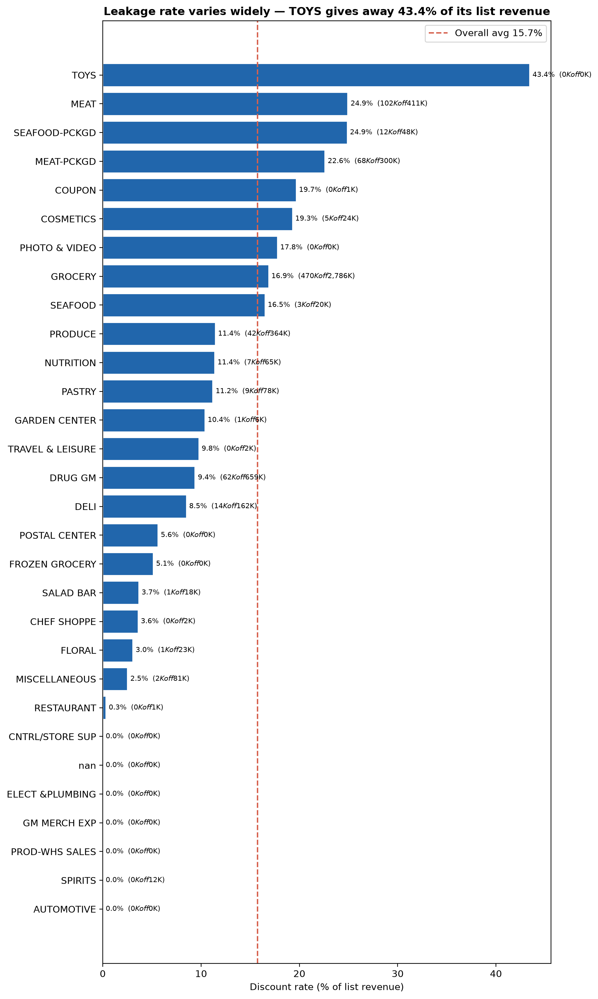
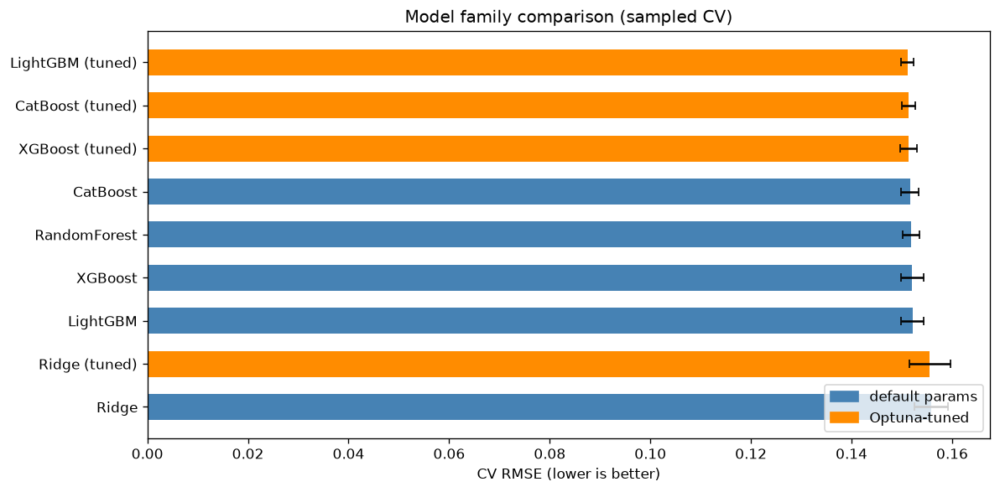
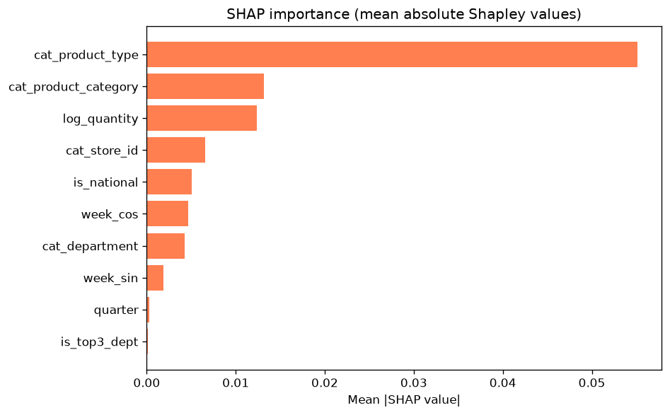
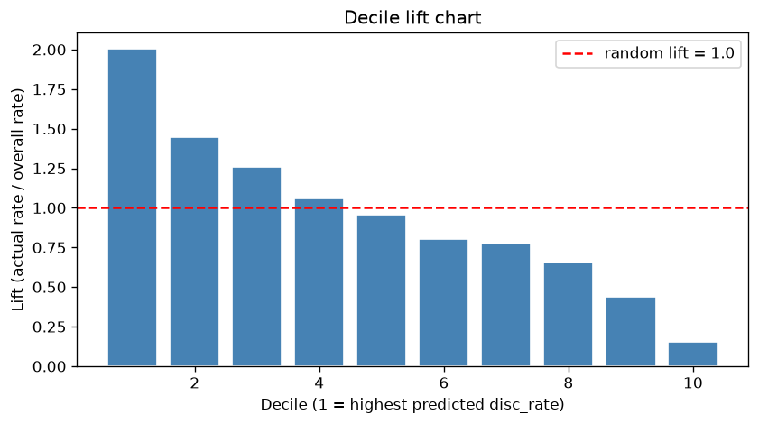
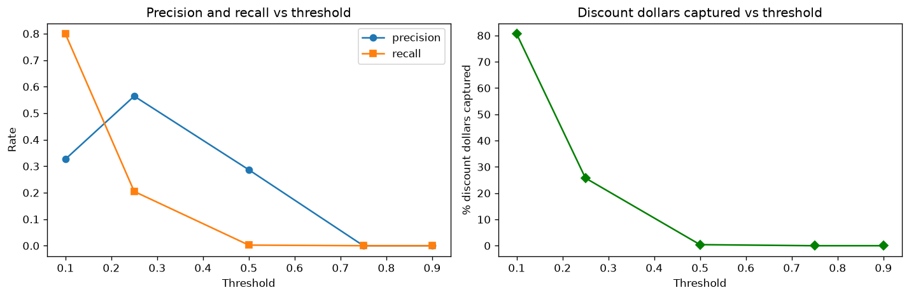

# Discount Leakage Audit: Final Report

**Project:** 02 Discount Leakage Audit, Dunnhumby "The Complete Journey"
**Date:** 2026-10-28
**Scope:** one year of loyalty-card grocery sales, 2,467 households and 437 stores (the "panel"). All dollars are panel dollars, not chain totals.

**How to read the labels.** Every number carries one of four labels.
*measured* = counted directly from the data. *modeled* = an output of the prediction model; it shows association, not cause. *external* = a published source, with its link. *assumed* = a value someone chose; change it if you have a better one.

**Source keys used in citations.**

| Key | File |
|---|---|
| PD | `problem_description.md` |
| FND | `reports/exploration/findings.md` |
| HYP | `reports/exploration/hypotheses.md` |
| CLN / QA | `reports/exploration/cleaning_log.md` / `quality_audit.md` |
| MC | `reports/modeling/model_card.md` |
| TUN | `reports/modeling/tuning.md` |
| HO | `reports/ml_handoff_report.md` (s. = section) |
| MEMO | `reports/executive_growth_strategy.md` (s. = section) |
| FU | `reports/ml_followups.md` (Qn = round 1, R2-Qn = round 2) |
| DLG / NBR | `reports/agent_dialogue.md` / `reports/notebook_review.md` |
| NB03 | `notebooks/03_modeling.ipynb` (cell outputs) |
| T01-T03 | `reports/tables/01_decile_targeting.csv`, `02_value_at_risk_by_threshold.csv`, `03_smallest_intervention.csv` |

---

# Part A. The answer in plain language

## The question, as the client asked it

How much list revenue leaks to discounts? Where does it concentrate? Which promotions fail to pay back? What margin comes back if the worst ones are trimmed? [PD]

## The answer

The panel gave away $797,186 in discounts, 15.7% of $5,063,618 list revenue. Almost all of it, $777,398, came out of the chain's own margin. The money is not spread evenly. It sits in deep markdowns on a short list of products, mostly in GROCERY and MEAT. Discount above a 25% depth ceiling is $227,564 a year, and 383 products hold half of it. Nobody can yet say which promotions pay back, because the data holds no measure of extra sales caused by a promotion. The team's planning case is $100K to $150K a year of recovered margin on the panel, but that figure rests on assumptions. Tested pilots should come before any chain-wide cut.

## The numbers that matter

| # | Number | What it means for the decision | Label and source |
|---|---|---|---|
| 1 | $797,186 discount, 15.7% of $5,063,618 list revenue; $777,398 of it retailer-funded | The cost is large and the chain controls almost all of it. | measured; FND F1, HO s.1, chart 01 |
| 2 | $227,564 above a 25% depth ceiling, 28.5% of all discount dollars | This is the most a depth cap could touch, before any lost sales. | measured; FU Q2 |
| 3 | 383 products hold 50% of that above-ceiling money (of 21,926 with any) | The review list is short enough for one pricing analyst. | measured; FU R2-Q4 |
| 4 | $386,820, 48.5% of discount dollars, has no promotion record | Half the spend is "silent" markdowns that no one plans or reviews. | measured; FU Q6 |
| 5 | $100K-$150K a year recoverable margin (planning case); $76.5K from the model's own rule | A useful prize, but it depends on how shoppers react. | assumed (planning case); modeled ($76.5K); MEMO s.3c, FU Q3 |

## What should happen next

1. Require sign-off for any retailer-funded markdown deeper than 25%, and finance sign-off above 35% (MEMO s.4B).
2. Audit supplier funding received outside the till, then ask suppliers of the top 200 national-brand products to fund deep deals (MEMO s.4B, Pilot 3).
3. Run a 12-week depth-cap test in 40 matched store pairs on the 383 products, leaving out five traffic categories (MEMO s.5 Pilot 1).
4. Hold out 20% of stores from each mailer promotion to measure which events pay back (MEMO s.5 Pilot 2).
5. Bring silent markdowns into the same approval calendar and log every price event at the till (MEMO s.4A, s.4B).

## What is uncertain

- No promotion's extra sales were measured, so payback is unknown; the recovery range assumes how shoppers respond.
- Product cost and off-till supplier funding are not in the data; the margin math uses an assumed 33% margin.
- The model explains 17% of line-to-line variation; its scores are a ranking aid, not a precise forecast.

---

# Part B. How we got there

## B1. The data: one year of loyalty sales, cleaned to 1,445,035 lines

**What it is.** Dunnhumby "The Complete Journey", released as the `completejourney` R package under a CC0 (public domain) licence [PD]. It covers 2017-01-01 to 2017-12-31 for a panel of loyalty-card households.

| Table | Rows | What it holds |
|---|---|---|
| transactions | 1,469,307 | One row per product per shopping trip, with sales and three discount fields |
| products | 92,331 | Department, category, type, brand (national or private label) |
| promotions | 20,940,529 | Which product was in the mailer or on display, per store and week |
| coupons / redemptions / campaigns | 116,204 / 2,102 / 6,589 | Coupon and campaign links |
| demographics | 801 | Age, income, household size for about one-third of households |

Source: PD. Data dictionary: `reports/exploration/data_dictionary.md`.

**Key definitions** [data dictionary]. *List revenue* = pocket revenue plus all discounts. *Pocket revenue* (`sales_value`) = what the retailer keeps. *Retailer-funded discount* = loyalty markdown plus coupon match. *Manufacturer-funded discount* = manufacturer coupon. *disc_rate* (discount rate) = total discount divided by list revenue, per line.

**How it was checked and cleaned** [QA, CLN].

| Step | Rows after | Rule and reason |
|---|---|---|
| Raw transactions | 1,469,307 | Starting point |
| Exact duplicates | 1,469,307 | 0 found |
| Remove zero or negative sales value | 1,458,081 | 11,226 lines; these are returns or voids |
| Remove zero quantity | 1,458,032 | 49 more lines |
| Exclude FUEL | 1,445,035 | 12,997 lines; fuel is sold in gallons, not items (HO s.2) |

Other checks: no negative discounts (0 lines); 17 product IDs missing from the products table; 1,668 households have no demographics [QA]. Week numbers run 1 to 53 [QA]. The analysis base is 1,445,035 lines, 2,467 households, 437 stores, 68,178 active products [FND; HO s.2].

## B2. What exploration found

### Finding 1. $797K leaks to discounts, and the retailer pays 97% of it

$5,063,618 list revenue becomes $4,266,433 pocket revenue. Retailer-funded discounts take $777,398 (15.4% of list). Manufacturer coupons take about $20K (0.4% of list) [measured; FND F1, HO s.4 F1, chart 01]. **Reliability:** accounting totals, no estimation [FND].

### Finding 2. Promoted lines run about three times deeper: 31.2% vs 10.3%

Lines matched to a promotion event carry a 31.2% discount rate. Unmatched lines carry 10.3% [measured; FND F3]. The difference in medians is 31 points (95% confidence interval [the range likely to hold the true value] 31.0 to 31.5 points) [measured; HYP H1]. The rank-biserial effect size [a 0-to-1 measure of how separated two groups are] is 0.584, which is large. **Reliability:** reliable, but the promotions table may miss events, so this is a floor [FND; HO s.4 F3].

### Finding 3. A few products drive the money: 7% of products hold 80% of discount dollars

5,027 of 68,178 active products drive 80% of discount dollars [measured; FND F5, chart 03]. The top 20% of products hold 94.9% [measured; HYP H6]. **Reliability:** exact count on the full population [FND].

### Finding 4. TOYS has the highest rate, but GROCERY holds the money

| Department | Discount $ | Share of discount $ | Rate |
|---|---|---|---|
| GROCERY | $469,588 | 58.9% | 16.9% |
| MEAT | $102,393 | 12.8% | 24.9% |
| MEAT-PCKGD | $67,784 | 8.5% | 22.6% |
| DRUG GM | $61,721 | 7.7% | 9.4% |
| PRODUCE | $41,646 | 5.2% | 11.4% |
| SEAFOOD-PCKGD | $11,897 | 1.5% | 24.9% |
| TOYS | under $1K | about 0% | 43.4% |

All measured; FU Q1. The top three departments by rate (TOYS, MEAT, SEAFOOD-PCKGD) have a median line rate of 16.6% against 2.9% elsewhere [measured; HYP H4]. Effect size 0.152, medium. **Reliability:** reliable for rates; chart 02 ranks by rate, so it overstates TOYS (MEMO s.1).

### Finding 5. Households are not the lever: income explains about 5% of variation

Income band explains 5% of the variation in household discount rate (eta-squared [share of variation explained by a grouping] 0.052, small) [measured; HYP H5, HO s.4 F5]. The top 10% of households by rate take only 12.9% of discount dollars [measured; FU Q8]. **Reliability:** reliable, small effect. Demographics cover only about one-third of households [QA].

## B3. How the model was built and tuned: four tree models tie, CatBoost was chosen

**What the model does.** For every sales line it predicts the discount rate, a number from 0 to 1 [MC]. High scores mark lines for promotion review. It ranks lines; it does not judge payback.

**How it was tested.** Train on weeks 1-39 (1,057,007 lines); test once on the later weeks (388,028 lines), never seen in training [MC; HO s.3]. Inside training, cross-validation [repeated train-and-check on slices of the training data] used TimeSeriesSplit [slices that always validate on later weeks than they train on] [MC].

**What was compared** (CV RMSE [root mean squared error: the typical size of a prediction miss, here in discount-rate units]; lower is better; 200,000-line sample) [NB03 cells 15, 30; chart 05].

| Model | Default settings | After Optuna tuning |
|---|---|---|
| CatBoost [a tree model that handles categories directly] | 0.1516 | 0.1513 |
| LightGBM [a fast tree model] | 0.1521 | 0.1511 |
| XGBoost [another tree model] | 0.1520 | 0.1514 |
| Random Forest [many averaged decision trees] | 0.1519 | not tuned |
| Ridge [a straight-line baseline model] | 0.1558 | 0.1556 |

All measured on cross-validation; NB03, TUN.

**Optuna tuning in plain words.** Optuna [a tool that tries many setting combinations and learns which to try next] ran 60 trials per tree model with the TPE sampler [a search method that favours settings near past good results] [TUN]. All 180 trials ran to completion; the study files record no stopped trials [measured; `models/optuna_*.db`]. Parameter importance [how much each setting moved the score] showed CatBoost was most sensitive to `random_strength` (0.41) and `iterations` (0.27). In plain words, it needed randomness to avoid over-fitting and enough trees, more than fine depth [TUN; HO s.5]. LightGBM was most sensitive to `subsample` (0.28); XGBoost to `reg_alpha` (0.43) [TUN].

**Why CatBoost won.** The tuned tree models finished within 0.001 of each other [measured; HO s.5, TUN]. LightGBM scored best (0.1511). CatBoost (0.1513) was within one standard deviation [the usual spread of scores across slices], and the notebook chose it as simpler [NB03 cell 30]. The handoff adds that it handles categories without a separate encoding step [HO s.5]. See Part C for a wording discrepancy here.

**How good it is on the held-out test** [MC; final_config.json].

| Measure | CatBoost | What it means |
|---|---|---|
| RMSE | 0.147 | Typical miss is about 15 points of discount rate. |
| R² [share of variation explained] | 0.173 | Explains 17%; predicting the average explains 0%. |
| Capture at top 10% | 28.7% | The top-scored 10% of lines hold 28.7% of discount dollars, 2.9 times random. |
| ECE [calibration error: gap between predicted and actual rates] | 0.011 | Predicted rates match actual rates on average. |
| Baselines | Ridge 0.1516; simple business rule 0.1617 | The model beats both [NB03 cell 35]. |

All modeled.

**Where it is weaker** [modeling/tables/segment_performance.csv].

| Segment | Test lines | RMSE |
|---|---|---|
| Top-3 departments (TOYS, MEAT, SEAFOOD-PCKGD) | 14,762 | 0.171 |
| All other departments | 373,266 | 0.146 |
| National brands | 277,324 | 0.150 |
| Private label or unknown | 110,704 | 0.138 |

Treat scores in the deepest departments as directional [HO s.5]. Demographics were left out because they cover about one-third of households [MC].

## B4. What drives the predictions: product type dominates; pack size is the main lever

SHAP [a method that splits each prediction into the share each input contributed] ranks inputs by their average effect [modeling/tables/shap_importance.csv].

| Driver | Mean SHAP | Can the business change it? |
|---|---|---|
| Product type | 0.0551 | No, structural |
| Product category | 0.0132 | No, structural |
| Quantity bought (log) | 0.0124 | Yes: multi-buy and bulk deal rules |
| Store | 0.0066 | Weakly: store spread is narrow (FU Q5) |
| National vs private label | 0.0051 | Negotiable: decides who funds depth |
| Week of year (cos, sin) | 0.0047, 0.0019 | Yes: promotion calendar |
| Department | 0.0043 | No, structural |

All modeled. Classification from HO s.6 and MEMO s.3d.

**Counterfactual sensitivity** [what the model predicts if one input is changed, all else fixed]. Halving quantity on 97,000 eligible lines lowers the predicted rate by 2.05 points (95% interval 2.03 to 2.08). That links to $13,671 of discount [modeled; modeling/tables/counterfactual_sensitivity.csv; HO s.6]. This is an association, not a proven effect.

**What the model lacks.** Promotion depth, mailer slot and supplier funding are the real levers, and none is a model input [MEMO s.3d]. Quantity is known only after the sale, so the model can audit past promotions but not screen planned ones [MEMO s.3d].

## B5. Value at risk: the top fifth of lines holds half the discount money

**By decile** [one-tenth of lines, ranked by predicted rate]. Full year, all lines [T01].

| Decile | Lines | Mean predicted rate | Actual discount $ | Cumulative share |
|---|---|---|---|---|
| 1 (highest) | 144,504 | 31.7% | $268,417 | 33.7% |
| 2 | 144,503 | 22.9% | $121,201 | 48.9% |
| 3 | 144,504 | 18.7% | $98,013 | 61.2% |
| 4 | 144,503 | 15.6% | $81,708 | 71.4% |
| 5 | 144,504 | 13.2% | $68,066 | 80.0% |

Modeled ranking, measured dollars. Note: T01 includes the training weeks. On the held-out test only, decile 1 holds 28.7% and has a lift [actual rate divided by the average] of 2.0 [modeled; modeling/tables/decile_table.csv].

**By threshold** [the predicted rate above which a line is flagged]. Full year [T02; corrected values per FU corrections item 2].

| Flag lines predicted at | Lines | Share of lines | Actual discount $ | Share of discount $ |
|---|---|---|---|---|
| 10% or more | 858,028 | 59.4% | $686,180 | 86.1% |
| 20% or more | 309,892 | 21.4% | $404,724 | 50.8% |
| 25% or more | 162,139 | 11.2% | $286,425 | 35.9% |
| 30% or more | 71,732 | 5.0% | $176,428 | 22.1% |

On the test weeks, a 25% threshold gives precision [share of flagged lines that truly are deep] of 56% and recall [share of deep lines that get flagged] of 20% [modeled; modeling/tables/threshold_table.csv].

**Smallest intervention** [T03].

| Goal | Lines to review | Share of lines | Predicted rate at or above |
|---|---|---|---|
| Reach 50% of discount $ | 301,305 | 20.9% | 20.2% |
| Reach 80% of discount $ | 723,333 | 50.1% | 12.1% |

**Model-rule saving.** Capping test lines predicted above 25% at 25% gives $20,585 [modeled; MC, HO s.3]. Over a 14-week window that annualises to about $76,500 [modeled; FU Q3]. It assumes no volume response [assumed; HO s.7].

## B6. The strategy: a depth problem on a short list, with payback unproven

**Internal metrics against external benchmarks** [MEMO s.2].

| Metric | This panel | Benchmark | Reading |
|---|---|---|---|
| Share on promotion | 22.5% of lines (measured; FU Q6) | 24.4% of US food sales on deal, 2022; 31% in 2019 (external; [FoodNavigator/Bernstein](https://www.foodnavigator.com/Article/2022/12/21/2022-in-review-Rampant-inflation-the-end-of-the-honeymoon-period-for-plant-based-meat-and-added-sugar-under-attack?page=4)) | In line; breadth is not the issue |
| Depth on promoted lines | 31.2% all; 34.4% mailer only; 36.5% mailer plus display (measured) | A 30% cut beat a 50% cut on margin, BCG egg example (external; [BCG 2015](https://www.bcg.com/en-us/publications/2015/retail-pricing-how-retailers-can-improve-promotion-effectiveness.aspx)) | Mailer depth at or above that point |
| Promotions failing to break even | Unknown (no measure) | Almost three-quarters (external; [Nielsen via FoodNavigator](https://www.foodnavigator.com/Article/2014/10/09/Three-quarters-of-CPG-promotions-don-t-break-even-Nielsen)) | Blind spot |
| Supplier-funded share of discount | 2.5%, $20K of $797K (measured) | Retailers claim about half of trade funds (external; [Grocery Dive](https://www.grocerydive.com/news/grocery--study-25-of-retailers-increased-ad-budgets-but-left-funds-unclaimed/534857/)) | Likely under-recorded or under-claimed |
| Net profit margin | Not in data | 1.7% (external; [FMI 2025](https://www.fmi.org/newsroom/latest-news/view/2025/07/15/fmi-report--amid-uncertainty--food-industry-succeeds-in-offering-shoppers-value)) | Discount is about nine times a typical net margin |
| Gross margin | Not in data | Kroger 22.3% of sales, FY2024 (external; [Kroger IR](https://ir.kroger.com/news/news-details/2025/Kroger-Reports-Fourth-Quarter-and-Full-Year-2024-Results-Announces-Guidance-for-2025/)) | Basis for the 33% margin assumption |
| Margin gain available | $76.5K, 1.8% of pocket revenue (modeled) | 2-5 points (external; BCG 2015); 8% vendor claim (external; [Antuit](https://www.casestudies.com/company/antuit/case-study/regional-grocery-chain-optimizes-promotion-pricing-to-compete-more-effectively)) | Low end; likely conservative |
| Where promotion volume comes from | Promo-week units 4.5x normal (measured, not causal; FU Q4) | About 75% of lift is brand switching (external; [Bell et al. 1999](https://ideas.repec.org/a/inm/ormksc/v18y1999i4p504-526.html)) | Much of the 4.5x is likely switching |

**The levers and their size** [MEMO s.1, s.3c].

| Lever | Annual $ (panel) | Label |
|---|---|---|
| Depth ceiling at 25%, model-targeted | $76.5K | modeled |
| Depth ceiling at 25%, all lines, no volume loss | $227.6K | measured |
| Depth ceiling at 35% only | $107.1K | measured |
| Planning case: 25% cap outside traffic categories, net of volume loss | $100K-$150K | assumed |
| Supplier funding recovery, 5-10% of $618.3K national-brand discount | $31K-$62K | measured base, assumed rate |
| Mailer payback discipline | protects $360K of mailer-linked discount; recoverable share unknown | measured base |

**The below-cost test** [MEMO s.3b]. At an assumed 33% front margin [margin at list price before discounts], lines 25% or deeper ($1,507K list, $604K discount, 40.1% average depth) sell about $107K a year below cost [list and discount measured, FU R2-Q1; margin assumed]. A 25% retailer-funded markdown needs about 4.1 times normal volume to break even [assumed].

**Recommendations by track** [MEMO s.4].

| Track | Action | Basis |
|---|---|---|
| A. Technical | Weekly scoring rolled up to product-store-week; top products to category managers each Monday | modeled ranking |
| A | Retrain a planning model without quantity, using planned depth, mailer, display, funding | design note |
| A | Hold out stores every cycle; build toward an uplift model [one that ranks events by extra margin caused] | measured gap |
| A | Add a price-event log, supplier funding per event, unit cost, trip counts | measured gap |
| A | Retrain quarterly; alert if error exceeds 0.16 | threshold assumed |
| B. Commercial | Sign-off above 25% depth, finance sign-off above 35% ($107.1K tier) | measured |
| B | Supplier funding sprint on the top 200 national-brand products | assumed rate |
| B | Promote private label ($178.9K discount) with display, not deep price | measured |
| B | Pull silent markdowns ($386.8K) into the approval calendar | measured |
| B | Avoid stacking deep events in weeks 21-23 and 27 | measured |
| B | Add margin per promotion dollar to category manager scorecards | assumed |

**Pilots** [MEMO s.5].

| Pilot | Design | North star [the main outcome] | Decision rules |
|---|---|---|---|
| 1. Depth cap hold-out | 40 matched store pairs, 383 products less 5 traffic categories, 12 weeks | Gross margin $ per store-week | Day 30 kill if traffic falls over 2%; day 90 scale if margin up 2%+ and traffic within 1% |
| 2. Mailer payback hold-out | Random 20% of stores per mailer cycle, 6 cycles, about 12 weeks | Incremental margin per $ of discount, per event | Day 60 drop bottom third of events; kill if hold-out traffic falls over 2% |
| 3. Supplier funding sprint | Half of top national-brand categories randomised in, 90 days | Net retailer-funded discount $ | Day 30 re-base if off-system funding covers over half; day 90 scale if net cost falls 5%+ |
| 4. Private label display swap | 30 matched pairs, top 100 own-brand products, 10 weeks | Own-brand gross margin $ | Day 30 kill if share drops 3+ points; day 90 scale if margin up 3%+ |
| 5. Multi-buy depth rule | 30 matched pairs, top 100 multi-buy products, 8 weeks | Gross margin $ on test products | Day 30 kill if units fall 20%+; scale if margin up 3%+ |

Sample sizes are assumed and need store-level variance to confirm [MEMO s.5].

**Prioritisation** [MEMO s.6].

| Initiative | Impact | Time to value | Wave |
|---|---|---|---|
| Depth sign-off rule | High | 2-4 weeks | 1 |
| Supplier funding audit and sprint | Medium-high | 4-8 weeks | 1 |
| Silent markdown review | Medium | 4-6 weeks | 1 |
| Private label depth policy | Medium | 6 weeks | 1 |
| Weekly review list from the model | Medium | 4-6 weeks | 1 |
| Depth cap hold-out (Pilot 1) | High | 12 weeks | 2 |
| Mailer payback hold-out (Pilot 2) | High | 12 weeks | 2 |
| Multi-buy rule (Pilot 5) | Low-medium | 8 weeks | 2 |
| Price-event log and unit cost data | Enabler | 3-6 months | 2 |
| Uplift model | High | 6-9 months | 3 |
| Reinvest saved depth in everyday prices | High | 6-12 months | 3 |

## B7. The agent dialogue: 13 questions in two rounds, none declined

The growth-strategy partner asked the statistician 13 questions by direct message [DLG]. Answers are in FU. Questions below are verbatim from DLG; answers are summarised from FU with their numbers.

**Round 1** (preamble: "Growth-strategy partner here: round 1 of follow-up questions on the Discount Leakage handoff (project 02)...")

| # | Memo section | Question (verbatim) | Answer (FU) | What changed |
|---|---|---|---|---|
| 1 | s.3 Segment economics | "Discount $ share of total by department: GROCERY, MEAT, MEAT-PCKGD, DRUG GM, PRODUCE, SEAFOOD-PCKGD, TOYS. I want to show that the dollar pool is GROCERY-led even though TOYS has the top rate." | GROCERY $469,588 (58.9%); TOYS about $0 at 43.4% | GROCERY framed as the pool; chart 02 warning added |
| 2 | s.3 Cap economics | "Using ACTUAL disc_rate on all 52 weeks (not predicted): discount $ above a 25% cap, a 35% cap and a 50% cap. Plus the share of discount $ sitting on lines with actual rate >= 25%, >= 40%, >= 50%." | $227,564 / $107,138 / $15,978 above caps; 25%+ lines hold 75.8% | Upper end of Lever 1; Pilot 1 trigger |
| 3 | s.3 Annualisation | "Overall disc_rate and discount $ in the test window, weeks 40-52, vs weeks 1-39. Is annualising the $20,585 an over- or understatement?" | Test window is 14 weeks; about $76,500 a year | Model saving cut from $82.3K to $76.5K |
| 4 | s.5 Payback test | "Volume response proxy: for the top 100 SKUs by discount $, the median ratio of units sold per week when disc_rate >= 20% vs < 5%, and the IQR." | Median 4.5x, IQR 3.3x-6.7x, not causal | Below-cost test; Pilot 2 justification |
| 5 | s.4 Store ceiling | "Store spread: across stores with >= $10K list revenue, count, p10/median/p90 disc_rate, and stores above 20%." | 108 stores; 13.8% / 15.9% / 18.5%; 4 above 20% | Store ceiling dropped as a lever |
| 6 | s.3 Promotion mechanics | "From the promotions join: disc_rate and discount $ for display only / mailer only / both / neither. Plus the share of discount $ on promo-matched lines." | Mailer only $255,927 at 34.4%; both $104,004 at 36.5%; display $50,435 at 17.6%; unmatched $386,820 (48.5%) | Lever 3; Pilot 4; silent markdown action |
| 7 | s.3 Brand | "Discount $ split national vs private label (dollars and share)." | National $618,316 (77.6%); private $178,870 (22.4%) | Lever 2, Pilots 3 and 4 |
| 8 | s.3 Households | "Share of total discount $ captured by top 10% and top 20% of households ranked by disc_rate, and their list revenue share." | Top 10%: 12.9% of discount, 7.6% of list | Household targeting ruled out |

**Round 2** (preamble: "Round 2 (final) follow-up questions from the growth-strategy partner on project 02...")

| # | Memo section | Question (verbatim) | Answer (FU) | What changed |
|---|---|---|---|---|
| 1 | s.3 Below-cost test | "List revenue on lines with actual rate >= 25% and >= 40% (discount $ already given; need list $ for average rate)." | $1,507,472 at 40.1%; $718,828 at 49.2% | Below-cost table; -$107K estimate |
| 2 | s.3 / Pilot 1 | "Split $227,564 above the 25% cap by promo group (both/mailer only/display only/unmatched) and by brand (national/private)." | Mailer-linked 59.6%; unmatched 34.5%; national 80.5% | New above-cap table |
| 3 | s.3 / Pilot 1 | "$227,564 above the 25% cap by department: top 5 departments and top 10 product categories." | GROCERY 53.9%; five traffic categories $69K (30.4%) | Traffic carve-out in Pilot 1 |
| 4 | s.4 SKU review list | "How many SKUs hold 50% and 80% of the $227,564 above the 25% cap?" | 383 and 2,529 | Pilot 1 list cut from 500 to 383 |
| 5 | s.3 Seasonality | "Discount $ in week 27 and weeks 21-23, and the excess over the 53-week weekly mean." | Week 27 +$5,668 (37.7%); weeks 21-23 +$5,948 | Calendar "worth managing, not a main lever" |

**Corrections the statistician volunteered** [FU corrections]: the 14-week window; HO s.7a dollars were modeled, not actual; decile dollars should come from T01; F2's 2.9% vs 16.6% are medians. No question was declined and nothing is open [DLG].

**Notebook review outcome** [NBR].

| Stage | Gaps found | Fixed | Remaining |
|---|---|---|---|
| 01 exploration | 6 | 6 (68 cells, 0 errors) | 3: formulas placed after code (cell 17); "why this method" and "alternatives" missing on H2-H7 cells; pre-registration table not written to `hypotheses.md` |
| 02 features and 03 modeling | 10 | 10 (36 and 66 cells, 0 errors) | 2: alternatives missing in NB02 cell 24; `features.md` still lacks formula, expected direction and example columns for all features |

The review rule allowed one fix round per stage, so 5 documentation gaps remain. None affects a number [NBR].

---

# Part C. Checks and limits

## C1. Consistency check

**Numbers that appear in two or more reports.**

| Number | Where | Status |
|---|---|---|
| List revenue $5,063,618; discount $797,183-$797,186 | FND, HO s.3, FU | Agree (under $5 rounding) |
| Clean lines 1,445,035; train 1,057,007 / test 388,028 | HO s.3, FU Q3 | Agree |
| Recoverable $20,585 | MC, final_config.json, HO s.3 | Agree |
| Test window length | MC and final_config say weeks 40-52; HO says 13 weeks and $82,340 a year | **Discrepancy.** FU Q3: weeks 40-53, 14 weeks, about $76,500. MEMO uses the corrected figure |
| Threshold table "actual disc $" | HO s.7a shows $648,882 etc. | **Discrepancy.** These are modeled values; actual is $686,180 etc. in T02 (FU correction 2) |
| Decile dollars | HO s.7b $268,451, $121,198, $98,002, $81,698, $68,059 | **Minor discrepancy.** T01 gives $268,417, $121,201, $98,013, $81,708, $68,066 (FU correction 3) |
| Model choice | HO s.5 says CatBoost (0.1513) "edged" LightGBM (0.1511) | **Discrepancy.** Lower is better, so LightGBM scored best; NB03 chose CatBoost as within one standard deviation and simpler |
| Driver ranking | MC lists category/type, department, store, brand, season, quantity | **Discrepancy.** SHAP table puts quantity 3rd and department 7th; permutation importance puts brand 2nd |
| Seasonal peaks | MC says Q1 and Q3 | **Discrepancy.** FU R2-Q5 shows peaks in weeks 21-23, 27, 28, 45 and 52 |
| Exploration chart 04 title | "more than double" | **Discrepancy** flagged by MEMO s.3a: week 27 is 1.27 times the average rate (1.38 times on dollars, HYP H7) |
| Chart 04 promoted vs not | HO s.9 calls it a median comparison | **Discrepancy.** HYP H1 gives medians of 31.3% and 0.0%; 10.3% matches the dollar-weighted rate of unmatched lines (FU Q6) |
| Brand finding | FND F4 says "H3 confirmed" | **Discrepancy.** HYP H3 verdict is "NOT SUPPORTED" (small effect) |
| Brand rates | FND F4: retailer-funded 15.5% private vs 15.3% national; FU Q7: total 15.6% vs 15.8% | Different measures; both say the two are close |
| Households, stores | MC says ~2,400 households, 457 stores | Minor: 457 is the raw store count; the clean base is 2,467 households and 437 stores |
| Row walk | HO s.2 says "1,458,032 raw, minus 11,275..., minus 12,997" | Wording error: raw is 1,469,307 (CLN); the end count 1,445,035 is right |
| CV folds | MC says 5 folds for comparison; its benchmark heading and TUN say 3 | Unclear which applied to the benchmark |
| Top-decile capture | 28.7% (MC, test only) vs 33.7% (T01, full year) | Different bases; T01 includes training weeks |
| Precision 56%, recall 20% at 25% | HO s.9, MEMO s.3e, threshold_table.csv | Agree |
| Top-decile lift 2.0 | HO s.9, decile_table.csv, MEMO s.6 | Agree |
| Counterfactual $13,671, -2.1 points | HO s.6, MEMO s.3d, CSV | Agree; CSV label "0.693 → 0.693" does not state the direction |

**Strategy claims with no supporting number in the handoff report.** These rest on assumptions, follow-ups or sources outside HO.

| Claim (MEMO) | Basis |
|---|---|
| 33% front margin; -$107K below cost; break-even multiples | assumed margin; list and discount from FU R2-Q1 |
| Planning case $100K-$150K | assumed volume loss and carve-out |
| Supplier recovery 5-10% ($31K-$62K) | assumed rate |
| True lift about 1.9x | assumed, from external Bell 1999 |
| Pilot effect sizes (2-5%, 40-70%, 3-6%, 10-20%) and sample sizes (35-45 pairs, 20 stores) | assumed |
| Drift alert at 0.16 RMSE | assumed |
| Top categories: soft drinks $63K, beef $39K, chicken $34K, milk $28K | exploration chart 05, not HO |
| "Lorenz curve steepest in first 1-2%" | read visually from chart 03 |
| Category managers paid on sales; review takes minutes | assumed |
| All follow-up figures (GROCERY pool, $227.6K, 383 products, silent markdowns) | measured in FU, not in HO |

**Benchmarks marked unverified or weak** [MEMO s.2, s.6].

| Item | Status |
|---|---|
| 84.51 personalised offer redemption 10-15% | Page returned HTTP 403; mentioned as unverified only |
| Progressive Grocer "almost half of purchases on promotion" | HTTP 403; not used |
| Bijmolt et al. (2005) price elasticity -2.62 | HTTP 403; not used |
| Gross margin benchmark | Single company (Kroger) used as a proxy |
| Antuit 8% margin gain | Vendor claim |

## C2. Limitations and failure modes

| # | Limitation | Effect | Source |
|---|---|---|---|
| 1 | No measure of extra sales caused by a promotion | Recoverable margin may be overstated; payback cannot be judged | HO s.8 #1, MC, FND |
| 2 | Product cost and off-till supplier funding absent | Margin math rests on an assumed 33%; "97% retailer-funded" may overstate cost | MEMO s.3b, s.6 |
| 3 | Panel only; chain loyalty household count unknown | Dollars cannot be scaled to the chain yet | MEMO scope note |
| 4 | Promotions table matches 22.5% of lines | 48.5% of discount has no event record; promoted rate is a floor | HO s.8 #4, FU Q6 |
| 5 | One year of data | Cannot separate trend from seasonality | HO s.8 #2, MC |
| 6 | Model explains 17% of variation; weaker in deep departments (RMSE 0.171) | Line scores are directional | MC, segment_performance.csv |
| 7 | Quantity is known only after the sale | Model audits the past; cannot screen planned promotions | MEMO s.3d |
| 8 | Model is association only | Lowering a score does not prove money is saved | MC |
| 9 | Demographics cover about one-third of households | No household targeting | MC, QA |
| 10 | Store geography absent | A store with unusual depth may go unseen | HO s.8 #6 |
| 11 | Model fixed to 2017 | Scores degrade without retraining | HO s.8 #7 |
| 12 | Brief asked for an offer sheet and a payback test | No file titled offer sheet exists; payback test not possible with this data | PD, file listing |

## C3. Instrumentation gaps, in priority order

| # | Gap | Fix | Source |
|---|---|---|---|
| 1 | Incremental sales per promotion | Store hold-outs every promotion cycle | HO s.8 #1, MEMO s.4A |
| 2 | Unified price-event log at the till | Record every markdown, type, planned depth and funder | HO s.8 #4, MEMO s.4A |
| 3 | Supplier funding per event | Join scan-back, billback and off-invoice money to lines | MEMO s.4A |
| 4 | Unit cost per product-week | So margin, not only discount, is measured | MEMO s.4A |
| 5 | Basket and trip counts per household | To measure traffic effects of traffic items | MEMO s.4A |
| 6 | Multi-year history | Retrain on 2+ years | HO s.8 #2 |
| 7 | Demographic coverage | Capture at loyalty sign-up | HO s.8 #3 |
| 8 | Store-level monitoring | Store markdown guardrail and rolling 4-week error check | HO s.8 #6-7 |

---

# Part D. Appendix

## D1. Glossary

| Term | Plain meaning |
|---|---|
| Annualise | Scale a part-year figure to a full year. |
| Billback / off-invoice | Supplier pays after the deal / cuts the invoice price up front. |
| Brand switching | Shoppers buy the promoted brand instead of another they would have bought. |
| Break-even unit multiple | How many times normal volume a deal must sell to earn the same margin. |
| CatBoost | A tree-based prediction model that handles categories directly. |
| Confidence interval (95%) | The range likely to hold the true value. |
| Counterfactual sensitivity | What the model predicts if one input changes and all else stays fixed. |
| Cross-validation (CV) | Repeatedly training on part of the data and checking on another part. |
| Decile | One-tenth of lines, ranked by predicted discount rate. |
| Depth / discount rate (disc_rate) | Discount as a share of list price on a line. |
| Drift | Model accuracy falling as conditions change. |
| ECE | Calibration error: the gap between predicted and actual rates. |
| Effect size (rank-biserial r) | A 0-to-1 measure of how separated two groups are; above 0.30 is large. |
| Eta-squared | Share of variation explained by a grouping; under 0.06 is small. |
| Front margin | Margin at list price, before discounts. |
| Gross margin | Sales minus product cost, as a share of sales. |
| Guardrail metric | A measure that must not get worse during a pilot. |
| Hold-out test | Keep a random group untreated to measure the true effect. |
| Incremental sales / lift (promotion) | Sales that happened only because of the promotion. |
| IQR | The middle half of values, from the 25th to the 75th percentile. |
| Leakage | Discount dollars between list revenue and pocket revenue. |
| Lift (model) | A group's actual rate divided by the overall average. |
| LightGBM / XGBoost | Other tree-based prediction models. |
| List revenue | Sales at shelf price before any discount. |
| Lorenz curve | A chart showing how concentrated a total is across items. |
| Mailer / display | A promotion in the weekly flyer / on a special in-store display. |
| Manufacturer-funded discount | A discount the manufacturer pays back to the retailer. |
| Matched store pairs | Similar stores paired so one gets a change and one does not. |
| Median | The middle value when values are sorted. |
| Net profit margin | Profit after all costs, as a share of sales. |
| North star metric | The main outcome a pilot is judged on. |
| Optuna | A tool that searches model settings, learning which to try next. |
| Panel | The 2,467 loyalty households in the data. |
| Parameter importance | How much each model setting moved the tuning score. |
| Permutation importance | How much accuracy drops when one input is shuffled. |
| Pocket revenue | What the retailer keeps after all discounts. |
| Precision | Share of flagged lines that truly are deep. |
| Private label / national brand | The retailer's own brand / an outside manufacturer's brand. |
| R² | Share of variation the model explains; 0 means no better than the average. |
| Random Forest | Many decision trees averaged together. |
| Recall | Share of truly deep lines that get flagged. |
| Retailer-funded discount | A markdown paid from the retailer's own margin. |
| Ridge | A straight-line baseline model. |
| RMSE | The typical size of a prediction miss. |
| Scan-back | Supplier pays per unit scanned during a deal. |
| SHAP | A method that splits each prediction into each input's share. |
| Silent markdown | A loyalty-card price cut with no promotion record. |
| SKU | One product in one size. |
| Standard deviation | The usual spread of values around their average. |
| Threshold / cutoff | The score above which a line is flagged. |
| TimeSeriesSplit | Cross-validation that always checks on later weeks than it trains on. |
| TPE sampler | Optuna's search method; it favours settings near past good results. |
| Traffic driver | A product shoppers make trips for, such as milk or meat. |
| Uplift model | A model that ranks actions by the extra outcome they cause. |

## D2. Chart manifest

| File | What it shows | Key takeaway |
|---|---|---|
| `reports/charts/01_price_waterfall.png` | List revenue to pocket revenue, step by step | $797K (15.7%) lost; $777,398 retailer-funded; manufacturer slice barely visible |
| `reports/charts/02_leakage_by_department.png` | Discount rate by department, sorted by rate | TOYS 43.4% tops the rate list; dollar labels are garbled in the image, and a "nan" department appears |
| `reports/charts/03_leakage_concentration.png` | Lorenz curve of discount dollars across products | 7% of products hold 80% of discount dollars |
| `reports/charts/04_promoted_vs_not.png` | Discount rate on and off promotion | 31.2% vs 10.3% |
| `reports/charts/05_model_comparison.png` | CV RMSE for five model families, default and tuned | Tree models cluster near 0.151; Ridge near 0.156 |
| `reports/charts/06_shap_importance.png` | Mean SHAP value per input | Product type dominates; quantity is third |
| `reports/charts/07_decile_lift.png` | Lift by predicted decile, test weeks | Top decile 2.0x; bottom decile 0.16x |
| `reports/charts/08_threshold_curves.png` | Precision, recall and dollars captured by threshold | At 25%: precision 56%, recall 20%, 26% of dollars |

Further charts sit in `reports/exploration/charts/` (8) and `reports/modeling/charts/` (15).

## D3. Web sources

| Source | One-line summary |
|---|---|
| [FoodNavigator / Nielsen 2014](https://www.foodnavigator.com/Article/2014/10/09/Three-quarters-of-CPG-promotions-don-t-break-even-Nielsen) | Almost three-quarters of US promotions do not break even. |
| [BCG 2015](https://www.bcg.com/en-us/publications/2015/retail-pricing-how-retailers-can-improve-promotion-effectiveness.aspx) | Promotions are 10-45% of revenue; 2-5 points of margin available; 30% beat 50% depth. |
| [FMI 2025](https://www.fmi.org/newsroom/latest-news/view/2025/07/15/fmi-report--amid-uncertainty--food-industry-succeeds-in-offering-shoppers-value) | US food retailer net margin 1.7%; shoppers remain price-worried. |
| [Kroger IR FY2024](https://ir.kroger.com/news/news-details/2025/Kroger-Reports-Fourth-Quarter-and-Full-Year-2024-Results-Announces-Guidance-for-2025/) | Gross margin 22.3%; own brands lifted margin; media income $1.35B. |
| [Grocery Dive](https://www.grocerydive.com/news/grocery--study-25-of-retailers-increased-ad-budgets-but-left-funds-unclaimed/534857/) | Retailers claim about half of available trade funds. |
| [Bell, Chiang, Padmanabhan 1999](https://ideas.repec.org/a/inm/ormksc/v18y1999i4p504-526.html) | About 75% of promotional lift is brand switching. |
| [FoodNavigator / Bernstein 2022](https://www.foodnavigator.com/Article/2022/12/21/2022-in-review-Rampant-inflation-the-end-of-the-honeymoon-period-for-plant-based-meat-and-added-sugar-under-attack?page=4) | 24.4% of US food sales on deal in 2022, 31% in 2019. |
| [Antuit case study](https://www.casestudies.com/company/antuit/case-study/regional-grocery-chain-optimizes-promotion-pricing-to-compete-more-effectively) | Vendor claim: 8% margin gain at a regional grocer. |

## D4. Files produced

| File | Description |
|---|---|
| `notebooks/01_exploration.ipynb` | Quality audit, cleaning, price waterfall, leakage maps and seven pre-registered hypothesis tests (68 cells). |
| `notebooks/02_feature_engineering.ipynb` | Builds and documents the ten model inputs with correlation checks (36 cells). |
| `notebooks/03_modeling.ipynb` | Model comparison, Optuna tuning, held-out test, SHAP, deciles, thresholds and counterfactuals (66 cells). |
| `reports/final_report.md`, `reports/final_report.html` | This report and its interactive page. |
| `reports/executive_growth_strategy.md` | Strategy memo: levers, benchmarks, pilots, priorities. |
| `reports/ml_handoff_report.md` | Statistician's handoff: findings, model, value at risk, failure modes. |
| `reports/ml_followups.md`, `reports/agent_dialogue.md` | Follow-up answers and the question log. |
| `reports/notebook_review.md` | Notebook review gaps and fixes. |
| `reports/customer_discount_scores.csv` | 1,445,035 scored lines with predicted rate and decile. |
| `reports/charts/` (8 PNG) | Report charts listed in D2. |
| `reports/tables/01-03_*.csv` | Decile, threshold and smallest-intervention tables. |
| `reports/exploration/` | findings, hypotheses, data dictionary (.md, .csv), cleaning log, quality audit, handoff to modeling, `clean.parquet`, 8 charts. |
| `reports/modeling/` | model card, tuning, features (.md, .parquet), scores.csv, 6 tables, 15 charts. |
| `models/` | `discount_leakage_model.joblib`, `final_config.json`, `tuning_summary.json`, three Optuna study databases. |
| `src/` | `explore_utils.py`, `features.py`, `model_utils.py`, `pipeline.py`. |
