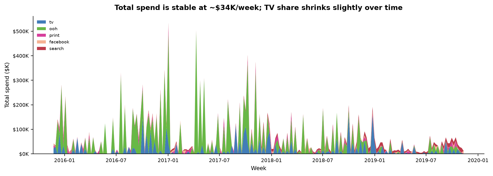
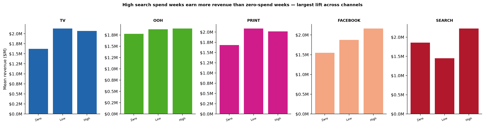
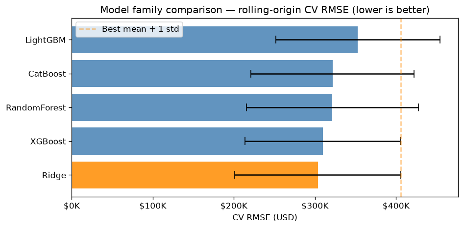
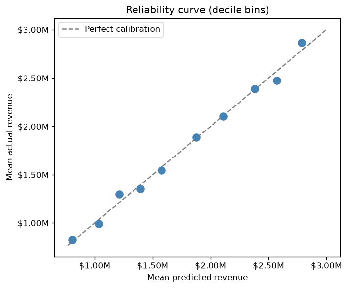
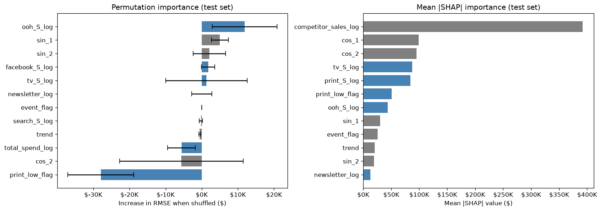
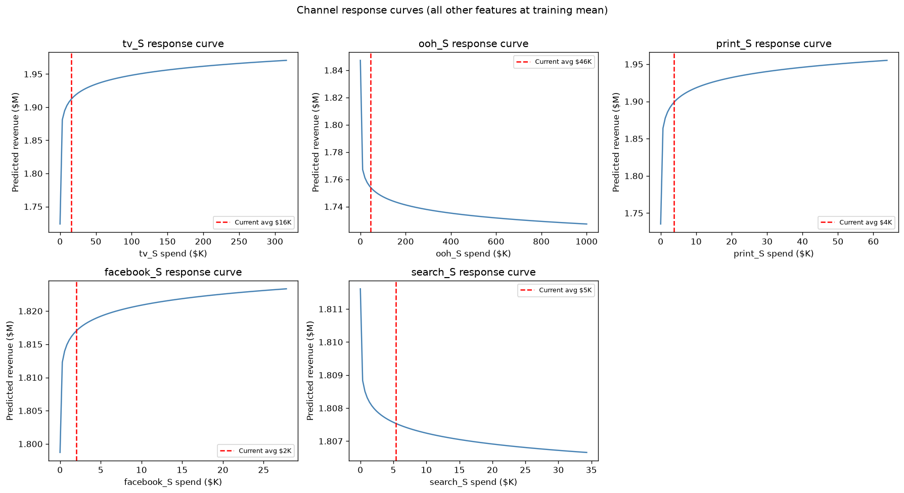
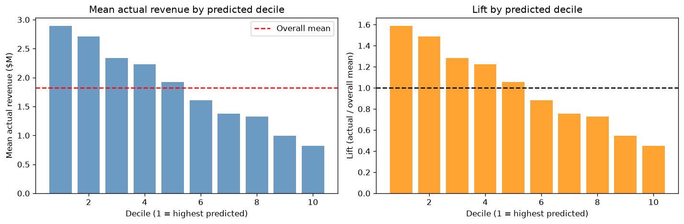

# Marketing Budget Reallocation: Final Report

**Project:** 04-marketing-budget-reallocation-mmm · **Prepared by:** report-writer · **Date:** 9 Nov 2026
**Data:** Meta Robyn simulated weekly dataset (208 weeks, Nov 2015 to Nov 2019) and Google Meridian simulated geo data (20 regions, 156 weeks). Both datasets are simulated.

**How to read this report.** Part A is the answer for a business reader. Part B shows each stage of the work. Part C lists every check and limit. Part D holds the glossary, charts, sources and files.

**Evidence labels.** Every number carries one of four labels.
- **measured**: counted directly from the data.
- **modeled**: produced by the statistical model; an association, not proof of cause.
- **external**: taken from a published source, with its link.
- **assumed**: an estimate made by the team, not checked against data.

**Source codes used in citations.**

| Code | File |
|---|---|
| PD | `problem_description.md` |
| FIN, DD, CL, QA, HYP, HM | `reports/exploration/` findings.md, data_dictionary.md, cleaning_log.md, quality_audit.md, hypotheses.md, handoff_to_modeling.md |
| MC, TUN, FE | `reports/modeling/` model_card.md, tuning.md, features.md |
| HR | `reports/ml_handoff_report.md` |
| MEMO | `reports/executive_growth_strategy.md` |
| FU | `reports/ml_followups.md` (R1 = round 1, R2 = round 2) |
| AD, NR | `reports/agent_dialogue.md`, `reports/notebook_review.md` |
| T01 to T04, Q8 | `reports/tables/01_...csv` to `04_...csv`, `q8_spend_by_year.csv` |
| MT | `reports/modeling/tables/` |

---

# Part A. The answer in plain language

## The question the client asked

A consumer brand spends about $34K a week on TV, out-of-home (billboards; OOH), print, Facebook and search (PD). Finance wants proof the split is right before approving next year's plan. The brief asks three things (PD):
1. What does each channel add to revenue?
2. Where does each channel stop paying back (saturate)?
3. How should the same total budget be split to earn the most revenue?

## The answer

Do not move money between channels yet. The model forecasts weekly revenue well, but it cannot tell which way a budget shift would move revenue. The business already ran a natural test: weekly media spend fell 72% from 2017 to 2019, and like-for-like revenue fell only 3.1%. Most of the cut was billboards. Next year, hold the 2019 mix, keep billboards behind a test gate, and use the gap up to $34K a week to pay for regional tests. Those tests, not this model, should decide the split.

## The numbers that matter

| # | Number | What it means for the decision | Label and source |
|---|---|---|---|
| 1 | Weekly media spend fell from $101.4K (2017) to $28.2K (2019), down 72%. Like-for-like revenue (weeks 1 to 45) fell 3.1%, from $1.712M to $1.658M a week. | Large cuts barely moved revenue. Any return to 2017 spending needs proof first. | measured; FU R1 item 8, FU R2 item 1 |
| 2 | Forecast error 6.0% (MAPE) on 20 weeks the model never saw; it explains 94% of weekly revenue swings (R² 0.943). | The model is fit for revenue forecasting and planning. | measured on held-out weeks; MC, MT test_metrics.csv |
| 3 | Moving 20% of TV money to Facebook changes revenue by -$2,129 a week on the model's curves. Eleven re-fits range from -$1,090 to +$15,470; six say gain, five say loss. | The model cannot say whether a shift helps or hurts. It must not set the split. | modeled; FU R1 item 3 |
| 4 | Revenue per extra $1 at average spend: print $4.74, TV $1.21, Facebook $0.96, search -$0.08, billboards -$0.19. Break-even is $2.00 at a 50% margin. | Only print clears break-even, and print's estimate is the least reliable (VIF 43.6). | returns modeled (FU R1 item 2); margin assumed (MEMO §3.1) |
| 5 | Search plus billboards took 58% of 2019 spend ($741K of $1.27M). The model credits neither. | Money sits where the evidence is weakest. Test these first. | spend measured (FU R2 item 2); credit modeled (FU R1 item 2) |

## What should happen next

| # | Action | Owner | Source |
|---|---|---|---|
| 1 | Correct the record to Finance: withdraw the 18% event lift, the "flat budget" claim and the "TV to Facebook is positive" claim. | Analytics | MEMO §4 Track B item 4 |
| 2 | Freeze the 2019 mix ($28.2K a week) as next year's base. No billboard spend above 2019 levels without a passed test. | Marketing, Finance | MEMO §4 Track B items 1, 3 |
| 3 | Ring-fence the $5.8K a week gap to the $34K plan (about $0.30M a year) as test money only. | Finance | MEMO §4 Track B item 2 |
| 4 | Run four tests in 90 days: TV switched off in some regions, print switched off in others, a Facebook lift test, and a brand-search pause. | Marketing, Analytics | MEMO §5 |
| 5 | Rebuild the model as a regional Bayesian model and feed it the test results. | Analytics | MEMO §4 Track A items 2, 3 |

## What is uncertain

- Both datasets are simulated, so no number here describes a real brand's results (PD).
- The model has no carry-over term, so TV and print value may be understated by up to about 2x (assumed; MEMO §2).
- The 50% gross margin behind every break-even rule is assumed; the true margin is unknown (MEMO §6).

---

# Part B. How we got there

## B1. The data: 208 weeks of simulated spend and revenue, checked and lightly cleaned

**What it is.** One row per week, 23 Nov 2015 to 11 Nov 2019, 208 rows (measured; DD). The target is weekly revenue in US dollars. Inputs are spend for five channels, newsletter sends, a competitor sales index and an event flag (PD; DD). A second, simulated regional file covers 20 regions over 156 weeks, 3,120 rows (measured; DD). It was used only to size tests (FU R2 item 4).

**Where it came from.** Both files are public simulations: Meta Robyn (MIT licence) and Google Meridian (Apache 2.0). Download commands are in PD.

**How it was checked.**

| Check | Result | Source |
|---|---|---|
| Missing values | 0 in all 27 columns | measured; DD |
| Duplicate rows | 0 in both datasets | measured; QA |
| Zero or negative revenue | 0 weeks | measured; QA |
| Regional file sums vs national file | 0.08% average gap across 156 weeks (rounding) | measured; QA |
| Facebook spend vs impressions | correlation 0.991 | measured; QA |
| Search spend vs clicks | correlation 0.983 | measured; QA |

**What was cleaned.** The text event column became a 0/1 flag. Rows were sorted by date. Regional revenue was built as conversions times revenue per conversion (CL). No rows were dropped (measured; CL).

**What was excluded and why.** Facebook impressions and search clicks were left out because each moves almost one-for-one with its spend column (measured; QA; HM). The date column was used only as a time index (HM).

**A data error found later.** The event flag marks 2 event weeks, not 15. The cleaning log shows 2 rows affected, but the findings and chart 08 say 15 (measured; CL, FU R1 item 6). See Part C.

## B2. What exploration found, and which findings survived

Exploration produced five findings (FIN). Follow-up checks overturned two of them and weakened one (FU R1). The table gives each finding with its final reliability verdict.

| # | Finding as first stated | Key number | Final reliability verdict | Chart |
|---|---|---|---|---|
| F1 | TV takes the largest budget share but shows the weakest revenue lift | 46% of typical-week spend; top TV quintile earns about 5% more revenue than bottom (measured; FIN) | **Weak.** Over four years TV was 21.3% of spend, not 46% (measured; T02). Unadjusted for season. | `reports/charts/06_revenue_by_spend_quintile_exploration.png` |
| F2 | Search shows the highest revenue lift | Top search quintile earns 49% more than bottom (measured; FIN) | **Weak.** Unadjusted; search ran mostly in later years. The fitted model gives search about zero return (modeled; FU R1 item 2). | same chart |
| F3 | Event weeks add 18% to revenue | 15 event weeks vs 193; p < 0.001 (FIN) | **Withdrawn.** Only 2 event weeks exist; lift is +35.1% on 2 weeks; not established (measured; FU R1 item 6). | `reports/charts/08_event_week_revenue_lift.png` (do not use) |
| F4 | Total budget is flat | Spearman ρ = -0.089, p = 0.200 (measured; FIN) | **Withdrawn.** Weekly spend fell 72% from 2017 to 2019 (measured; FU R1 item 8). | `reports/charts/07_spend_mix_over_time.png` |
| F5 | Channels move mostly independently, so their effects can be separated | Most pairwise spend correlations below 0.2 (measured; FIN) | **Partly holds.** Spend columns are separable, but print spend and the model's "print is zero" flag are near-duplicates (VIF 43.6; measured; FU R1 item 4). | `reports/exploration/charts/04_correlation_matrix.png` |

**What exploration could not check.** Causal return, carry-over between weeks, and price or promotion effects (FIN, "What we did not find").

*Chart 07. Spend was high and spiky in 2016 and 2017, driven by billboards, and much lower from 2018. The chart's own title ("stable at ~$34K/week") is wrong; see Part C.*

*Chart 06. Raw revenue by zero, low and high spend weeks per channel. Search and Facebook look strongest in raw data, but season is not removed.*

## B3. How the model was built and tuned: a simple Ridge model won narrowly

**What the model does.** It predicts weekly revenue from weekly spend, season and market conditions (MC). It learned from the first 188 weeks and was tested once on the last 20 weeks, May to Nov 2019 (MC).

**What it uses.** Fifteen inputs: the log of spend for each channel, newsletter sends, the competitor index, the event flag, total spend, a "print is zero" flag, a trend and four seasonal wave terms (FU R1 item 1). It does **not** use carry-over (adstock) or S-shaped saturation (Hill) terms, although those were built (FE; FU R1 item 1).

**What was compared.** Five model families, each scored on rolling-origin cross-validation [repeated train-on-past, test-on-future splits]. The model card says 10 splits; the follow-up found 11 (MC; FU R1 correction 6).

| Model family | Average error, CV RMSE | Spread (std) | Average % error, CV MAPE | After Optuna tuning |
|---|---:|---:|---:|---:|
| Ridge | $303,461 | $102,466 | 14.61% | $301,426 |
| XGBoost | $309,581 | $95,804 | 10.79% | $308,028 |
| RandomForest | $321,490 | $106,208 | 11.74% | not tuned |
| CatBoost | $321,703 | $100,709 | 14.42% | not tuned |
| LightGBM | $352,924 | $101,092 | 14.68% | $325,588 |

All measured on cross-validation; MT full_benchmark.csv; TUN.

**Optuna tuning in plain words.** Optuna [an automatic search tool that tries settings and learns which work] ran 60 trials for each of Ridge, XGBoost and LightGBM (TUN). It used the TPE sampler [a method that proposes new settings near past good ones] and a median pruner [stops trials that look worse than average]. The saved study files show all 60 Ridge trials finished; for XGBoost and LightGBM, 33 of 60 were stopped early (measured; `models/optuna_*.db`). Ridge has one setting, the penalty strength alpha; the best was 2.16 (TUN). Tuning improved Ridge by about $2K and LightGBM by about $27K of average error (measured; MT full_benchmark.csv).

**What parameter importance showed.** It cannot be reported. TUN points to `charts/optuna_importance_{family}.png`, but no such files exist in the project. For Ridge, alpha is the only tuned setting.

**Why Ridge was chosen.** It had the lowest average error and is easy to read (HR §4; MC). The win is narrow. All five families sit within one spread of Ridge (measured; chart 04). XGBoost had a lower spread and a lower % error than Ridge (measured; MT full_benchmark.csv). See Part C.

*Chart 04. Ridge has the lowest average error, but every family's error bar overlaps the line at Ridge's mean plus one spread.*

**How good it is on the held-out 20 weeks.**

| Measure | Value | Plain meaning | Label, source |
|---|---:|---|---|
| MAPE [average % error] | 6.0% | Off by about $118K on a typical $1.95M test week | measured; MC, MT test_metrics.csv |
| RMSE [typical dollar error, big misses weigh more] | $142,111 | Typical size of a weekly miss | measured; MT test_metrics.csv |
| MAE [average dollar miss] | $109,414 | Average size of a weekly miss | measured; MC |
| R² [share of swings explained] | 0.943 | Explains 94% of week-to-week revenue swings | measured; MT test_metrics.csv |
| Calibration ratio [average predicted / average actual] | 1.000 | No systematic over- or under-forecast | measured; MC |

*Chart 05. Average predicted revenue tracks average actual revenue in every tenth of weeks.*

**Where it is weaker.**
- It is weak at splitting credit between channels; coefficients for Facebook vary 5x across re-fits (modeled; FU R1 item 3).
- Largest misses fall in the highest billboard-spend weeks (HR §4).
- Training-period weekly misses have a spread of $231K, 12.7% of average revenue (measured; FU R2 item 3).
- It has never seen a radically different mix, such as no TV (MC).

## B4. What drives the predictions: season and market dominate; media is a small lever

**Drivers by type.** SHAP [the average dollar amount each input adds to a prediction] on the test weeks:

| Driver | Mean SHAP, $ per week | Type | Can the business change it? |
|---|---:|---|---|
| Competitor index (tracks season, r = 0.96) | $392,306 | Structural | No |
| Seasonal wave cos_1 | $99,305 | Structural | No |
| Seasonal wave cos_2 | $95,097 | Structural | No |
| TV spend | $87,477 | Controllable | Yes |
| Print spend | $84,227 | Controllable | Yes |
| "Print is zero" flag | $51,018 | Controllable (via print) | Yes |
| Billboard (OOH) spend | $43,541 | Controllable | Yes |
| Event weeks | $25,513 | Semi-controllable; only 2 weeks | Partly |
| Trend | $20,671 | Structural | No |
| Newsletter sends | $12,670 | Controllable | Yes |
| Facebook spend | $10,388 | Controllable | Yes |
| Search spend | $1,265 | Controllable | Yes |

All modeled; MT shap_importance.csv; r = 0.96 measured, FU R1 item 5. Remaining seasonal and total-spend terms are in the source table.

The competitor index moves with season at r = 0.96, so its share is "index plus season", not market demand alone (FU R1 item 5).

*Chart 02. Left: how much test error rises when each input is shuffled. Right: SHAP. The competitor index dwarfs every media channel.*

**Counterfactual sensitivities [what the model predicts if one channel's spend changes, all else fixed].** All modeled associations, not causes.

| Channel | Revenue per extra $1K at all-week average spend | Revenue per extra $1K at average active-week spend | 4-year credited revenue vs zero spend |
|---|---:|---:|---:|
| TV | +$1,211 (at $15.6K) | +$573 (at $33.6K) | +$17.6M |
| Print | +$4,735 (at $3.7K) | +$2,112 (at $8.9K) | +$14.9M |
| Facebook | +$962 (at $2.0K) | +$491 (at $4.4K) | +$1.9M |
| Search | -$80 (at $5.4K) | -$63 (at $7.0K) | -$0.7M |
| Billboards (OOH) | -$185 (at $46.4K) | -$82 (at $105.8K) | -$8.1M |

modeled; FU R1 items 2 and 7.

**What the curves can and cannot say.** Every curve flattens as spend rises because the model uses log of spend (FU R1 item 1). So "TV is saturated" is a property of the formula, not a finding (MEMO §1.3). Billboards and search slope down because their fitted weights are negative, cause unknown (FU R1 item 4).

*Chart 01. Predicted revenue at each spend level, red line at average spend. TV, print and Facebook rise then flatten; billboards and search fall.*

**Media versus baseline.** Setting the five channel terms to zero removes $25.7M, 6.8% of 4-year predicted revenue of $379.0M (modeled; FU R1 item 7). Setting all spend to zero removes $64.0M, 16.9%. That second figure extrapolates, since only 2 weeks had zero spend (FU R1 item 7).

## B5. Where the value sits: high-revenue weeks are predictable; the TV-to-Facebook shift is not

**Revenue by predicted tenth of weeks (decile).** Top rows; full table in T01.

| Decile (1 = highest predicted) | Weeks | Mean actual revenue | Lift vs mean | Cumulative share of 4-year revenue |
|---|---:|---:|---:|---:|
| 1 | 21 | $2,890,678 | 1.59x | 16.0% |
| 2 | 21 | $2,712,965 | 1.49x | 31.0% |
| 3 | 21 | $2,341,324 | 1.28x | 44.0% |
| 4 | 20 | $2,229,740 | 1.22x | 55.8% |
| 10 | 21 | $823,939 | 0.45x | 100.0% |

measured actuals, ranked by modeled predictions; T01. Total revenue $379.0M over 208 weeks (measured; HR §2).

*Chart 03. Weeks the model ranks highest really do earn more. This mostly reflects season, not media (MEMO §3.2).*

**Threshold table [how much revenue sits in the top X% of weeks].**

| Top % of weeks by prediction | Weeks | Share of revenue | Revenue in those weeks |
|---|---:|---:|---:|
| 10% | 21 | 16.0% | $60.7M |
| 25% | 52 | 37.3% | $141.3M |
| 50% | 104 | 66.4% | $251.8M |
| 75% | 156 | 86.1% | $326.2M |
| 90% | 187 | 95.4% | $361.7M |

measured; T03.

**Spend by channel against model credit (4 years).**

| Channel | 4-year spend | Share of spend | Active weeks of 208 | Share of media SHAP |
|---|---:|---:|---:|---:|
| Billboards (OOH) | $8,989,332 | 61.9% | 85 | 19.2% |
| TV | $3,087,488 | 21.3% | 92 | 38.6% |
| Search | $1,230,427 | 8.5% | 176 | 0.6% |
| Print | $775,556 | 5.3% | 87 | 37.1% |
| Facebook | $446,297 | 3.1% | 101 | 4.6% |

spend measured, SHAP modeled; T02.

**Smallest intervention.** The handoff proposed moving 20% of TV's active-week spend ($6,712 a week) to Facebook and called it positive (HR §6; T04). The follow-up found the net is -$2,129 a week on that basis, with the sign split across re-fits (modeled; FU R1 item 3). The memo replaced this shift with regional tests (MEMO §5, Pilot 2 note).

| Basis for the TV-to-Facebook shift | Net revenue change per week |
|---|---:|
| Curve, average active-week levels | -$2,129 |
| Curve, all-week averages | -$2,114 |
| Actual TV-active training weeks (82) | +$5,880 |
| All 188 training weeks | +$2,565 |
| 11 re-fits, range | -$1,090 to +$15,470 |

modeled; FU R1 item 3.

## B6. The strategy: hold the mix, gate billboards, and buy evidence with tests

**Where the business stands.** Spend was cut 72% while like-for-like revenue fell 3.1% (measured; FU). From 2018 to 2019, each cut dollar cost at most $1.82 of revenue, if media caused the whole dip (measured inputs, attribution assumed; MEMO §1.2).

**Internal metrics against external benchmarks.**

| Metric | This business | Benchmark | Reading | Sources |
|---|---|---|---|---|
| Paid media as % of revenue | 3.8% over 4 years; 1.7% in 2019 (measured) | 2.4% (external; Gartner 2025 via [MarTech](https://martech.org/cmos-brace-for-cuts-as-marketing-budgets-stay-flat/)) | Now below norm | HR §2; FU R2 |
| TV return | $1.21 per $1 same-week; $5.70 4-year average (modeled) | £5.94 full-profit TV; £1.87 short-term all-channel (external; [Thinkbox](https://www.thinkbox.tv/research/thinkbox-research/profit-ability-2-the-new-business-case-for-advertising)) | Average plausible; same-week likely understates | MEMO §2 |
| Long-term multiplier | not measured | £1.87 to £4.11, about 2.2x (external; Thinkbox) | TV and print may be understated up to 2x (assumed) | MEMO §2 |
| Print return | $19.2 per $1 4-year average (modeled) | no print return stated (external; Thinkbox) | Implausibly high; not identified | MEMO §2 |
| Search return | -$0.08 per $1 marginal (modeled) | brand keywords near zero; about $0.25 per $1 (external; [eBay study via Slate](https://www.slate.com/articles/business/harvard_business_review/2013/03/paid_search_ads_did_ebay_just_prove_they_don_t_work.html)) | Consistent | MEMO §2 |
| Billboard return | -$8.1M over 4 years (modeled) | +39% relative gain, no per-dollar figure (external; [Mediaweek](https://www.mediaweek.com.au/ooh-campaigns-perform-better-when-classic-and-digital-work-together/)) | Unverified; no per-dollar benchmark | MEMO §2 |
| Facebook return | $0.96 per $1 (modeled) | 10.4% lift, $130 incremental cost per order (external, vendor; [Rockerbox](https://www.rockerbox.com/customers/how-hourglass-cosmetics-validated-metas-true-impact-with-a-geo-holdout-test)) | Not comparable in units | MEMO §2 |

**Channel economics at the 2019 base.**

| Channel | 2019 spend per week | Share | Revenue per extra $1 | Clears $2.00 break-even? |
|---|---:|---:|---:|---|
| Search | $8,909 | 31.5% | -$0.08 | No |
| Billboards (OOH) | $7,556 | 26.8% | -$0.19 | No |
| TV | $7,298 | 25.8% | $1.21 | No on same-week basis |
| Print | $2,470 | 8.7% | $4.74 | Yes, but not identified |
| Facebook | $2,009 | 7.1% | $0.96 | No |

spend measured (FU R2 item 2); returns modeled (FU R1 item 2); break-even assumed at 50% margin (MEMO §3.1).

**Decision rules (assumed 50% margin; MEMO §3.3).**
- Scale a channel when a test's 90% lower bound on return is at least $2.00 per $1.
- Cut search or Facebook when the upper bound is below $2.00.
- Cut TV or print only when the upper bound is below $1.00, allowing for long-term effects.
- Otherwise hold and extend the test.

**Recommendations by track.**

| Track | Recommendation | Source |
|---|---|---|
| A: data | Use the model for forecasting only, not budget moves | MEMO §4 A1 |
| A: data | Rebuild as a regional Bayesian model; calibrate with test results | MEMO §4 A2, A3 |
| A: data | Drop print spend or the "print is zero" flag; separate season from the competitor index | MEMO §4 A4, A5 |
| A: data | Add brand/non-brand search, price index, regional sales, verified events, online/offline split | MEMO §4 A6 |
| A: data | Re-fit when 8-week average error tops 10% (assumed) | MEMO §4 A7 |
| B: commercial | Freeze the 2019 mix; billboards gated; release $5.8K a week as test money | MEMO §4 B1 to B3 |
| B: commercial | Correct the record to Finance | MEMO §4 B4 |
| B: commercial | Pay agencies on tested incremental return | MEMO §4 B5 |
| B: commercial | Concentrate flights in high-season weeks | MEMO §4 B6 |

**Provisional $34K a week plan.** Line amounts assumed; base shares measured (MEMO §4 Track B).

| Line | $ per week | Share | Basis |
|---|---:|---:|---|
| TV | 7,300 | 21% | 2019 level held |
| Billboards (OOH) | 4,000 | 12% | cut from $7.6K |
| Print | 2,500 | 7% | 2019 level, pending Pilot 1 |
| Facebook | 2,000 | 6% | 2019 level |
| Search | 8,900 | 26% | 2019 level, pending Pilot 4 |
| Test fund | 9,300 | 27% | $5.8K gap plus $3.5K from billboards |
| **Total** | **34,000** | **100%** | |

**Test sizing.** Regional revenue varies 27.6% week to week (measured on simulated regional data; FU R2 item 4). After matching test and control regions, remaining noise is taken as about 5% (assumed; MEMO §5.1). The smallest detectable effect [MDE] is then about 4.4% over 8 weeks and 3.6% over 12 (assumed). So regional tests can check TV's claimed 4.6% and print's 3.9% revenue share (modeled; FU R1 item 7). They cannot check Facebook or search.

**The pilots.**

| Pilot | Design | Hypothesis | Scale rule (Day 90 unless noted) | Kill rule | Guardrail |
|---|---|---|---|---|---|
| 1 Print go-dark | 6 test regions, 14 controls, synthetic control, 12 weeks | Revenue falls 0 to 4% | Drop ≥2.5%, CI excludes zero: raise print to about $4K a week | Drop <1%, upper bound <2.5%: halve print | Stop if drop >8%; pre-period fit ≥0.95 |
| 2 TV go-dark | 5 other test regions, 12 weeks plus 6 weeks after | Revenue falls 2 to 5% | Drop ≥3%: hold TV, test heavy-up | Upper bound <1%: cut TV 25% | Drop >8%; brand search volume |
| 3 Facebook lift | Meta Conversion Lift, 15% user holdout, $2K to $8K a week, 8 weeks, about $48K extra | Return $1 to $3 per $1 | Day 60 lower bound ≥$2.00: fund $6K a week | Day 60 upper bound <$1.00: back to $2K | Cost per incremental order; 3 per week frequency cap |
| 4 Brand search holdout | Pause brand keywords in 50% of regions, 8 weeks | Brand-search orders fall <15% | Day 30 recapture >85%: extend pause | Day 60 recapture <70% or competitor takes top slot: keep | Competitor bidding; total revenue |
| 5 Billboard re-entry (Wave 3) | Heavy-up in 5 regions, 12 weeks, only if Marketing wants billboards back | not stated | Lift above MDE and return ≥$2.00 | not stated | not stated |

All design values assumed; triggers measured or modeled; MEMO §5.

**Prioritization.**

| Initiative | Impact | Confidence | Time | Wave |
|---|---|---|---|---|
| Correct the record to Finance | High | High | 1 week | 1 |
| Freeze 2019 mix; no TV-to-Facebook shift | Medium | High | 1 week | 1 |
| Billboard gate at 2019 level | High | Medium | 2 weeks | 1 |
| Ring-fenced test fund | Medium | High | 2 weeks | 1 |
| Pilot 4 brand search | Medium | Medium | 4 weeks | 2 |
| Pilot 3 Facebook lift | Low to medium | Low | 3 weeks | 2 |
| Pilot 1 print go-dark | Medium | Low | 6 weeks | 2 |
| Pilot 2 TV go-dark | High | Medium | 8 weeks | 2 |
| Incremental-based agency pay | Medium | Medium | 1 quarter | 2 |
| Bayesian regional model | High | Medium | 1 to 2 quarters | 3 |
| Pilot 5 billboard re-entry | Low to medium | Low | 12 weeks | 3 |
| Event-calendar program | Unknown | Not established | needs data | 3 |

MEMO §6. Ratings are the strategist's judgement (assumed).

## B7. The agent dialogue: twelve questions in two rounds changed the main recommendation

The strategist sent 12 questions to the statistician in two rounds; all were answered and none declined (AD). Questions are verbatim from AD. Answers quote or condense FU.

### Round 1

| # | Question (verbatim, AD) | Memo section | Answer (FU R1) | What changed (AD) |
|---|---|---|---|---|
| 1 | "Final model features: which features are in the fitted Ridge model (the _log set, the _sat set, or both)? Give the Ridge coefficient for each of the five channel features (tv/ooh/print/facebook/search)." | §3 | "Fitted features (15, all in the _log set; no _sat features)". TV +19,505; OOH -8,685; print +19,867; Facebook +2,407; search -474 per log unit. | "TV is saturated" reframed as a formula effect; print marked not identified; Track A item 4 added. |
| 2 | "Marginal return at current spend: for each channel, the predicted weekly revenue change for +$1K spend at (a) the mean active-week spend and (b) the all-week average marked on 01_channel_response_curves.png." | §1, 3, 4 | TV +$1,211, OOH -$185, print +$4,735, Facebook +$962, search -$80 per $1K at all-week average. | Filled §3.1 returns; overturned "Facebook steepest curve". |
| 3 | "Table 04 scenario (TV -$6,712, Facebook +$6,712 per week): the model's predicted weekly revenue change in USD, and the range across the 10 CV folds' refits ... My read of chart 01 is that the TV loss may exceed the Facebook gain; please confirm or correct." | §1, 5 | "Net change: -$2,129 per week". 11 re-fits: -$1,090 to +$15,470. "the sign is not established by this model." | Main recommendation became "do not move budget yet"; shift replaced by Pilot 2. |
| 4 | "Collinearity: Pearson r (or VIF) for ooh_S_log vs total_spend_log, and search_S_log vs trend." | §3, G1 | r = 0.63, VIF 2.1 and 2.9; search vs trend r = 0.13. | Handoff collinearity claim corrected; no recommendation changed. |
| 5 | "Pearson r of competitor_sales_log with cos_1, and with each of the five channel _log features. I want to know if the competitor index may be absorbing media or seasonal effect." | §1, 3 | cos_1 0.961; Facebook 0.372; others 0.10 to 0.23. | "Market demand" became "index plus season"; Track A item 5; Pilot 3 trigger. |
| 6 | "Event weeks: chart 08 shows medians near $2.45M vs $1.85M (~32%), while the report says 18%. Please give mean and median for each group and which statistic the 18% uses." | §3 | 2 event weeks, not 15. Lift +35.1% on means. "The report's 18% and its 15-week group are not reproducible." | Events removed as a lever; Finance told to withdraw the 18%. |
| 7 | "Media vs baseline decomposition: share of 4-year predicted revenue attributable to the five channels combined (signed contributions vs a zero-spend counterfactual), if computable from the existing model." | §1 | +$25.7M, 6.8%; all-spend-zero +$64.0M, 16.9% (extrapolation). TV +$17.6M, print +$14.9M, OOH -$8.1M. | Average returns in §2; TV 4.6% and print 3.9% became claims Pilots 1 and 2 test. |
| 8 | "Total media spend by calendar year (2016, 2017, 2018, 2019 partial) in USD, and OOH share by year. Chart 07 looks like spend fell after 2017." | §2 | $101.4K a week (2017) to $28.2K (2019); OOH share 70% to 27%. "spend fell about 72% per week". | Largest effect: created §1.2 finding, withdrew "flat budget", led to billboard gate and Pilots 4 and 5. |

### Round 2

| # | Question (verbatim, AD) | Memo section | Answer (FU R2) | What changed (AD) |
|---|---|---|---|---|
| 1 | "Revenue by calendar year (2016, 2017, 2018, 2019 to 11 Nov): total, mean weekly, and mean weekly for the same weeks-of-year in 2018 vs 2019 (weeks 1–45). Plus mean residual (actual minus predicted) by year. This tests whether revenue held as OOH fell from $3.70M to $0.34M." | §2, 3 | Weeks 1 to 45: $1.712M to $1.658M a week, "-3.1%". Residuals "do not test the OOH lever". | Added the $1.82-per-cut-dollar point; billboard gate rated medium confidence. |
| 2 | "2019 spend split: per-week spend by channel (TV, OOH, Print, Facebook, Search) for 2019 weeks, and share of 2019 total. This is the true 'current plan' base." | §3 | Total $28,242 a week; search 31.5%, OOH 26.8%, TV 25.8%, print 8.7%, Facebook 7.1%. | Became the plan base and the 58% search-plus-billboard figure. |
| 3 | "Noise for test sizing: SD of training residuals in USD per week, and lag-1 autocorrelation of residuals." | §5 | $231,326 SD; lag-1 autocorrelation +0.077. | Cited in §5.1; no other change. |
| 4 | "Meridian geo file (data/raw/meridian_geo_media.csv): number of geos, median weekly revenue per geo, and median across geos of the coefficient of variation of weekly revenue." | §5 | 20 regions; median $320,657 per region-week; median variability 0.276; 7x size range. | Drove the test-sizing table and pilot cell sizes. |

**Corrections the statistician volunteered (FU R1, "Corrections").** Event weeks are 2, not 15. The collinearity cause was unsupported. "Market demand" is index plus season. The final model has no carry-over or saturation terms. The TV-to-Facebook direction was wrong. The split rule gives 11 folds, not 10.

**Notebook review outcome (NR).**

| Notebook stage | Gaps found, pass 1 | Fix rounds | Gaps open after pass 2 |
|---|---:|---:|---:|
| 01 exploration | 10 | 1 | 7 |
| 02 feature engineering and 03 modeling | 11 | 1 | 1 |

Pass 2 lists open gaps; some are new rather than unfixed pass-1 gaps, so a "fixed" count cannot be read from NR.

Remaining gaps: missing chart explanations and alternatives in notebook 01; a summary that labels H1 and H2 "Reliable" when output says "UNCLEAR"; H6 marked "RELIABLE" in one place and "no reliable correlation" in another; and a missing rationale before the response-curve cell in notebook 03 (NR). Only one fix round was allowed per stage (NR).

---

# Part C. Checks and limits

## C1. Consistency check: numbers that appear in two or more reports

| Item | Values found | Verdict |
|---|---|---|
| Held-out test error | MAPE 6.0%, RMSE $142K, R² 0.943 in MC, HR §4, MT test_metrics.csv, MEMO | **Agree** |
| Mean weekly revenue | $2.9M (FIN); $1.82M (HR §2, measured) | **Discrepancy.** HR flagged it; $1.82M is correct |
| Media spend as % of revenue | 1.2% (FIN); 3.8% 4-year (HR §2); 1.7% 2019 (MEMO) | **Discrepancy** in FIN; HR and MEMO differ only by period |
| Typical weekly spend | ~$34K mean (FIN, PD); mean $69.9K, median $31.4K (HR §2); $28.2K 2019 (FU R2) | **Discrepancy.** $34K fits only as a plan figure |
| TV share of spend | 46% (FIN F1, HR §3); 21.3% 4-year (T02); 25.8% 2019 (FU R2) | **Discrepancy.** 46% not reproducible from tables |
| Event weeks | 15 (FIN, DD, HM, chart 08); 2 rows affected (CL); 206 "na" rows (QA); 2 (FU R1) | **Discrepancy.** 2 is correct; 15 and 18% withdrawn |
| Event-week test | p < 0.001 (FIN); p = 0.0899, "UNCLEAR" (HYP H2) | **Discrepancy** within exploration files |
| Flat budget | "flat" (FIN F4, chart 07 title); 72% fall (FU R1 item 8) | **Discrepancy.** Withdrawn |
| Cross-validation splits | 10 (MC, HR §4); 11 (FU R1) | **Discrepancy.** 11 is the follow-up's count |
| Saturation method | adstock plus Hill (MC weaknesses 2 and 3, HR §7 G2 and G3, FE); log only (FU R1 item 1) | **Discrepancy.** Final model is log only |
| Ridge "lowest variance" | HR §4 says lowest; XGBoost std $95.8K < Ridge $102.5K (MT full_benchmark.csv) | **Discrepancy** |
| Ridge "wins clearly" | HR §8 says clearly; all families within one std (chart 04) | **Discrepancy**; also XGBoost had lower CV MAPE (10.79% vs 14.61%), and HM named MAPE the primary metric |
| "Tree models overfitted" | HR §4; no supporting number in any table | **Unsupported** |
| Facebook "steepest curve" | HR §1; FU R1 item 2 gives print $4.74, TV $1.21, Facebook $0.96 | **Discrepancy.** Withdrawn by MEMO |
| TV-to-Facebook direction | "positive" (HR §6, T04); -$2,129 a week (FU R1 item 3) | **Discrepancy.** Withdrawn |
| OOH and search slope cause | collinearity (HR §5, G1); r = 0.63 moderate (FU R1 item 4) | **Discrepancy.** Cause unknown |
| Search lift | top vs bottom quintile +49% (FIN F2); chart 06 shows zero/low/high bins, with search low below zero | **Discrepancy** between finding and chart |
| TV lift effect size | "r = -0.58 — a small effect" (FIN F1) and "small effect" (HYP H5) | **Inconsistent wording.** r of 0.58 is not small |
| H6 newsletter verdict | "RELIABLE" (HYP table); "no reliable correlation" (HYP text) | **Discrepancy**; flagged by NR |
| Decile numbering | tables: 1 = highest predicted (T01); `scores.csv`: 10 = highest predicted (measured) | **Labelling clash** between files |
| Facebook spend vs impressions | r 0.991 (QA); "0.97+" (HM); "> 0.95" (FIN) | **Agree** in substance |
| Memo arithmetic | 72% cut, $1.82 per cut dollar, $3.3M billboard gap, 0.54% of weekly revenue, 12.7% noise, $34,000 plan total, Pilot 1 cost about $0.2M | **Agree** with FU inputs |
| Matched-region noise | Memo formula gives 27.6% × √(1-0.97²) ≈ 6.7%; memo then uses "about 5%" pooled | **Assumed step**; MDE would be larger at 6.7% |

## C2. Strategy claims with no supporting number in the handoff report

| Claim | Where | Status |
|---|---|---|
| 50% gross margin and $2.00 break-even | MEMO §3 | assumed; no margin data |
| $0.2M to $0.6M yearly margin upside | MEMO §1.1 | assumed; derivation not shown |
| About $0.2M a year from brand search | MEMO Pilot 4 | assumed; "half of search is brand" |
| Long-term multiplier 2.2x applied to TV and print | MEMO §2, §3.3 | external, applied by assumption |
| Pilot hypotheses (0 to 4%, 2 to 5%, $1 to $3, <15%) | MEMO §5 | assumed |
| 8% stop guardrail, 3 per week frequency cap, 10% re-fit trigger | MEMO §4, §5 | assumed |
| Provisional plan line amounts | MEMO §4 | assumed |
| All 2019 and calendar-year figures | MEMO §1 to §5 | supported by FU, not by HR |

## C3. Benchmarks the memo marked unverified or weak

- No per-dollar billboard benchmark was found; label "unverified" (MEMO §2).
- Thinkbox TV saturation point (£330K) has no stated time basis (MEMO §2).
- Gartner figures come from secondary reports; the press release returned an error (MEMO §2, §7).
- The $40K per channel per month geo-test floor is an operator rule of thumb (Elevarus; MEMO §2).
- Hourglass and Analytic Partners results are vendor-supported single sources (MEMO §2, §7).
- Fetch failures not used: Gartner release (403), Circana TV blog (404), mi-3 Thinkbox (403), AdNews (403), ITV Media (404), NBER eBay PDF (MEMO §7).

## C4. Limitations and failure modes

| # | Limitation | Effect | Source |
|---|---|---|---|
| 1 | Both datasets are simulated | No result describes a real brand | PD |
| 2 | Channel credit is unstable; Facebook weight varies 5x across re-fits | Model cannot set the budget split | FU R1 item 3 |
| 3 | No carry-over term in the final model | TV and print value may be understated | FU R1 item 1; MEMO §2 |
| 4 | Curve shape fixed by log formula | "Saturation" is not learned from data | FU R1 item 1 |
| 5 | Print spend and its zero flag are near-duplicates (VIF 43.6) | Print return not identified | FU R1 items 1, 4 |
| 6 | Competitor index and season move together (r = 0.96) | Cannot separate demand from season | FU R1 item 5 |
| 7 | Negative billboard and search weights, cause unknown | Cannot direct cuts or increases | FU R1 item 4 |
| 8 | Only 2 event weeks, none in the test set | Event effect rests on two points | FU R1 item 6 |
| 9 | National data only | Effects cannot use regional variation | HR §7 G4 |
| 10 | 208 weeks | Wide uncertainty on each channel | HR §7 G5 |
| 11 | No price or promotion data | Price effects may be credited to media | HR §7 G6; FIN |
| 12 | Never tested on a radically different mix | Do not use for "no TV" scenarios | MC |
| 13 | Regional tests detect only effects above about 3.6% to 4.4% | Facebook and search need other designs | MEMO §5.1 |
| 14 | Facebook lift test sees online sales only | Offline effect missed | MEMO Pilot 3 |
| 15 | The brief asked for an offer sheet | No report in the project contains one | PD; all reports |
| 16 | Optuna parameter-importance charts are cited but missing | Tuning importance cannot be audited | TUN |

## C5. Instrumentation gaps, in priority order

| Priority | Gap | Why it matters | Source |
|---|---|---|---|
| 1 | Revenue and spend by region, at least 20 markets | Needed for every regional test and the rebuilt model | MEMO §4 A6 |
| 2 | Brand vs non-brand search split | Pilot 4 cannot run without it | MEMO §4 A6 |
| 3 | True gross margin | Every break-even rule depends on it | MEMO §6 |
| 4 | Weekly price and promotion index | Separates price effects from media | HR §7 G6 |
| 5 | Verified event calendar | Current file has 2 events, not 15 | MEMO §4 A6 |
| 6 | Online vs offline sales split | Needed to read Facebook lift | MEMO §4 A6 |
| 7 | A demand signal cleaner than the competitor index | Separates demand from season | MEMO §4 A5 |

---

# Part D. Appendix

## D1. Glossary

| Term | Plain meaning |
|---|---|
| Adstock / carry-over | Advertising effect that lasts into later weeks |
| Alpha | The penalty strength in a Ridge model; higher keeps weights smaller |
| Average return | Total credited revenue divided by total spend |
| Baseline revenue | Revenue expected with zero media |
| Bayesian model | A model that combines prior beliefs, such as test results, with data |
| Break-even return | Revenue per $1 needed to cover the spend; $1 divided by gross margin |
| Calibration (forecast) | Whether average predictions match average actuals |
| Calibration (Bayesian) | Setting a model's starting beliefs from experiment results |
| CatBoost, LightGBM, XGBoost | Tree-based model families that combine many small decision trees |
| Coefficient | The model's weight on an input |
| Collinearity | Two inputs moving together, so their effects cannot be separated |
| Confidence interval (CI) | Range likely to contain the true value |
| Correlation (r) | How closely two measures move together, from -1 to 1 |
| Counterfactual | The "what if" scenario a result is compared against |
| Cross-validation (CV), rolling-origin | Repeatedly train on earlier weeks and test on later weeks |
| CV (coefficient of variation) | Standard deviation divided by mean |
| Decile | One tenth of weeks, ranked by predicted revenue |
| Go-dark / heavy-up | Turn a channel off / raise it sharply in test regions |
| Gross margin | Revenue minus cost of goods, as a share of revenue |
| Hill curve / saturation | A formula for diminishing returns as spend rises |
| Holdout / regional test (geo holdout) | Some regions change spend; matched regions do not |
| Incremental return | Extra revenue caused by $1 of spend, measured by a test |
| Lift | A group's revenue divided by the overall average |
| MAE | Average dollar size of a forecast miss |
| MAPE | Average forecast miss as a percentage of actual revenue |
| Marginal return | Extra revenue from the next $1 of spend |
| MDE (minimum detectable effect) | Smallest true change a test can reliably see |
| MMM (marketing mix model) | A model linking weekly spend by channel to weekly revenue |
| Optuna | An automatic tool that searches for good model settings |
| OOH (out-of-home) | Billboards and other outdoor ads |
| Permutation importance | How much error rises when one input is shuffled |
| Pruner (median) | Stops tuning trials that look worse than average |
| p-value | Chance of a result this large if there were no real effect |
| R² | Share of revenue swings the model explains |
| Recapture rate | Share of brand-search orders that still arrive when ads pause |
| Residual | Actual minus predicted revenue |
| Response curve | Predicted revenue at each spend level for one channel, others held fixed |
| Ridge regression | A straight-line model that shrinks weights to avoid overfitting |
| RMSE | Typical dollar size of a forecast miss, with big misses weighted more |
| SHAP | Average dollar amount each input adds to a prediction |
| Spearman ρ | Correlation based on ranks rather than values |
| Synthetic control | A weighted blend of control regions that tracks the test regions |
| TPE sampler | A tuning method that proposes settings near past good ones |
| VIF (variance inflation factor) | How much collinearity inflates a weight's uncertainty; above 10 is severe |

## D2. Chart manifest

| File | What it shows | Key takeaway |
|---|---|---|
| `reports/charts/01_channel_response_curves.png` | Predicted revenue vs spend per channel, average spend marked | TV, print, Facebook flatten by formula; billboards and search slope down |
| `reports/charts/02_driver_importance_shap_permutation.png` | Permutation importance and SHAP on test weeks | Competitor index plus season dominate all media |
| `reports/charts/03_revenue_decile_lift.png` | Actual revenue and lift by predicted decile | Top decile earns 1.59x the mean; mostly season |
| `reports/charts/04_model_family_comparison.png` | CV error for five model families | Ridge lowest, but all within one spread |
| `reports/charts/05_model_reliability_calibration.png` | Mean actual vs mean predicted by decile | Forecasts are well calibrated |
| `reports/charts/06_revenue_by_spend_quintile_exploration.png` | Mean revenue in zero, low and high spend weeks per channel | Raw lifts, season not removed |
| `reports/charts/07_spend_mix_over_time.png` | Weekly spend by channel, stacked | Spend fell sharply after 2017; title claim of "stable" is wrong |
| `reports/charts/08_event_week_revenue_lift.png` | Event vs non-event revenue | Labelled 15 event weeks; data has 2. Do not use |
| `reports/modeling/charts/feature_vs_revenue.png` | Each input against revenue, training weeks | Competitor index and season track revenue closely (r 0.89); uses _sat features not in the final model |
| `reports/modeling/charts/` (other five) | Byte-identical copies of charts 01 to 05 | Same as above |

## D3. Web sources

| Source | One-line summary |
|---|---|
| [Thinkbox Profit Ability 2](https://www.thinkbox.tv/research/thinkbox-research/profit-ability-2-the-new-business-case-for-advertising) | TV full-profit return £5.94; all-channel £1.87 short-term, £4.11 with long-term effects |
| [MarTech on Gartner 2025](https://martech.org/cmos-brace-for-cuts-as-marketing-budgets-stay-flat/) | Marketing 7.7% of revenue; paid media 2.4% of revenue |
| [Campaign Asia on Gartner 2025](https://www.campaignasia.com/article/marketing-budgets-hold-at-7-7-in-2025-gartner-cmo-survey/502806) | Confirms 7.7%; half of CMOs at 6% or less |
| [Slate/HBR on eBay search study](https://www.slate.com/articles/business/harvard_business_review/2013/03/paid_search_ads_did_ebay_just_prove_they_don_t_work.html) | Brand keyword ads near zero incremental |
| [Google Meridian calibration docs](https://developers.google.com/meridian/docs/advanced-modeling/roi-priors-and-calibration) | How test results become model starting beliefs |
| [Meta GeoLift walkthrough](https://facebookincubator.github.io/GeoLift/docs/GettingStarted/Walkthrough/) | Power analysis first; pick markets by pre-period fit |
| [Rockerbox: Hourglass geo holdout](https://www.rockerbox.com/customers/how-hourglass-cosmetics-validated-metas-true-impact-with-a-geo-holdout-test) | 10.4% Meta lift; $130 incremental cost per order; fit 0.96 to 0.98 |
| [Elevarus spend-tier framework](https://elevarus.com/incrementality-testing-agencies-spend-tier-framework/) | About $40K per channel per month floor for 4-week geo tests |
| [Mediaweek on Analytic Partners OOH](https://www.mediaweek.com.au/ooh-campaigns-perform-better-when-classic-and-digital-work-together/) | Relative billboard gains; no per-dollar return |
| [Nielsen 2025 ROI Blueprint](https://www.nielsen.com/fr/news-center/2025/nielsen-unveils-makerting-roi-blueprint/) | 32% measure traditional and digital together |

## D4. Files produced

**Notebooks (read these first)**

| File | What it shows |
|---|---|
| `notebooks/01_exploration.ipynb` | Data checks, cleaning, charts and hypothesis tests behind the exploration findings |
| `notebooks/02_feature_engineering.ipynb` | Construction of log, carry-over, saturation, seasonal and flag features |
| `notebooks/03_modeling.ipynb` | Model comparison, Optuna tuning, held-out test, SHAP, deciles and response curves |

**Reports and tables**

| Folder | Files |
|---|---|
| `reports/` | final_report.md, final_report.html, ml_handoff_report.md, executive_growth_strategy.md, ml_followups.md, agent_dialogue.md, notebook_review.md, customer_risk_scores.csv (per-week scores despite the name) |
| `reports/exploration/` | findings.md, data_dictionary.md/.csv, cleaning_log.md, quality_audit.md, hypotheses.md, handoff_to_modeling.md, clean.parquet, charts/ (9 PNGs) |
| `reports/modeling/` | model_card.md, tuning.md, features.md, features.parquet, scores.csv, charts/ (6 PNGs), tables/ (7 CSVs) |
| `reports/tables/` | 01 to 04 CSVs and q8_spend_by_year.csv |
| `reports/charts/` | 8 PNGs listed in D2 |
| `models/` | mmm_model.joblib (fitted Ridge), optuna_ridge.db, optuna_xgboost.db, optuna_lightgbm.db |
| `src/` | explore_utils.py, features.py, model_utils.py, pipeline.py |
